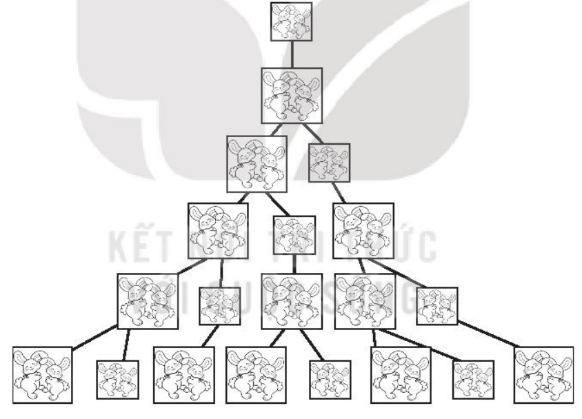

## Bài tập 23.1

a) 4 in A     b) 5 in A     c) 'Hà' in A
d) "Việt Nam" in A     e) '9' in A

## Bài tập 23.2

23.2. Cho A là một danh sách gồm các số nguyên. Em hãy viết các câu lệnh xác định và in ra số các phần tử lớn hơn 0 của A.

## Bài tập 23.3

23.3. Cho A là một danh sách gồm các số nguyên. Em hãy viết các câu lệnh tạo và in ra danh sách B chỉ gồm các số chẵn có trong A.

## Bài tập 23.4

23.4. Dãy Fibonacci. Dãy số Fibonacci được xác định như sau: F₀ = 0, F₁ = 1, …, Fₙ = Fₙ₋₁ + Fₙ₋₂ (với n lớn hơn hoặc bằng 2). Điều thú vị là dãy số này nảy sinh từ một bài toán thực tế — bài toán đếm thỏ. Một cặp thỏ (gồm một thỏ đực và một thỏ cái) cứ mỗi tháng đẻ được một cặp thỏ con (cũng gồm một thỏ đực và thỏ cái); một cặp thỏ con, khi tròn 2 tháng tuổi, sau mỗi tháng đẻ ra một cặp thỏ con, và quá trình sinh nở cứ thế tiếp diễn. Hỏi sau n tháng có bao nhiêu cặp thỏ, nếu đầu năm (tháng Giêng) có một cặp thỏ sơ sinh?

Trong hình vẽ trên, quy ước: Cặp thỏ nhỏ là cặp thỏ có độ tuổi 1 tháng. Cặp thỏ to hơn là cặp thỏ có khả năng sinh sản. Quan sát hình vẽ trên ta nhận thấy: Tháng Giêng và tháng Hai: Chỉ có 1 cặp thỏ. Tháng Ba: Cặp thỏ này sẽ đẻ ra một cặp thỏ con, do đó trong tháng này có 2 cặp thỏ.
