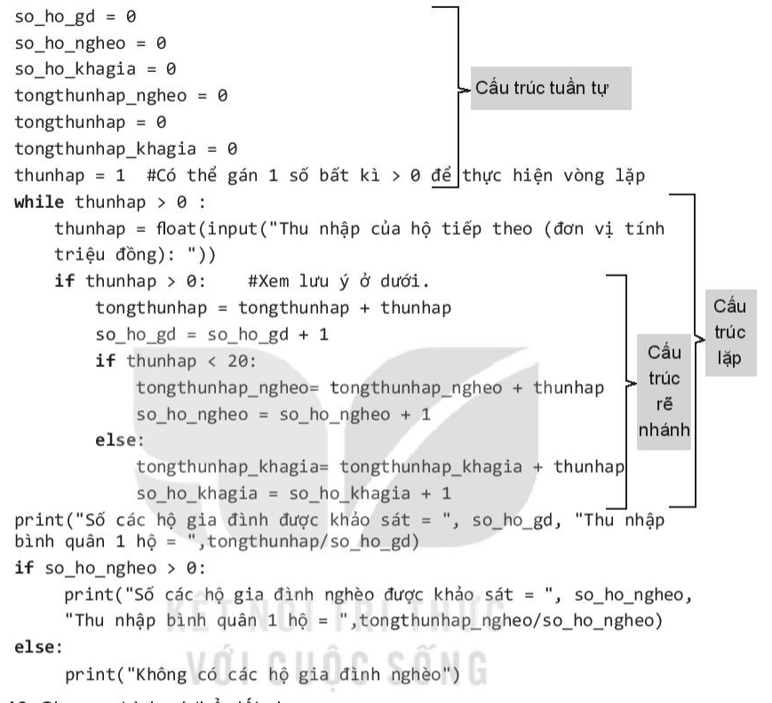

## Đáp án 21.12

21.12. Các khối lệnh tương ứng với các cấu trúc lập trình cơ bản:
```python
so_ho_gd = 0
so_ho_ngheo = 0
so_ho_khagia = 0
tongthunhap_ngheo = 0
tongthunhap = 0
tongthunhap_khagia = 0
thunhap = 1  #Có thể gán 1 số bất kì > 0 để thực hiện vòng lặp
while thunhap > 0 :
    thunhap = float(input("Thu nhập của hộ tiếp theo (đơn vị tính triệu đồng): "))
    if thunhap > 0:    #Xem lưu ý ở dưới.
        tongthunhap = tongthunhap + thunhap
        so_ho_gd = so_ho_gd + 1
        if thunhap < 20:
            tongthunhap_ngheo= tongthunhap_ngheo + thunhap
            so_ho_ngheo = so_ho_ngheo + 1
        else:
            tongthunhap_khagia= tongthunhap_khagia + thunhap
            so_ho_khagia = so_ho_khagia + 1
print("Số các hộ gia đình được khảo sát = ", so_ho_gd, "Thu nhập bình quân 1 hộ = ",tongthunhap/so_ho_gd)
if so_ho_ngheo > 0:
    print("Số các hộ gia đình nghèo được khảo sát = ", so_ho_ngheo, "Thu nhập bình quân 1 hộ = ",tongthunhap_ngheo/so_ho_ngheo)
else:
    print("Không có các hộ gia đình nghèo")
```
Cấu trúc tuần tự · Cấu trúc lặp · Cấu trúc rẽ nhánh


## Đáp án 21.13

21.13. Chương trình có thể viết như sau:
```python
# Xác định palindrom
so_bandau = int(input("Nhập số tự nhiên bất kì: "))
so_nghichdao = 0
k = so_bandau
while k > 0:
    so_nghichdao = so_nghichdao*10 + k % 10 # Từng bước tạo số nghịch đảo
    k = k // 10
if so_nghichdao == so_bandau:
    print("Số đã cho ", so_bandau, "là palindrom")
else:
    print("Số đã cho ", so_bandau, "không phải là palindrom")
```