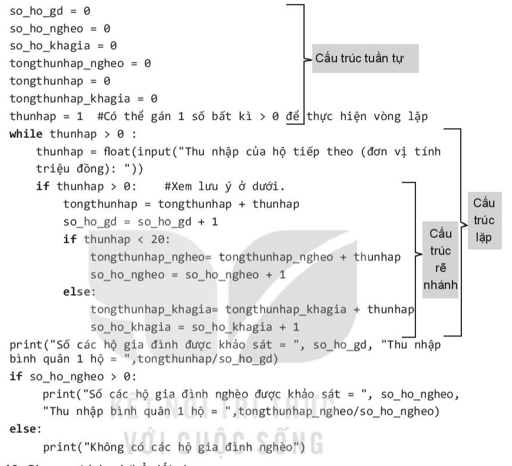

<!-- exercises 44 -->
21.1. Hãy cho biết đoạn chương trình sau sẽ in những gì ra màn hình? Khi nào thì quá trình in kết thúc?
<!-- exercises 45 -->
a)
```python
i = 1
while i < 5 :
    print(1/(i + 2), end = " ")
    i = i + 1
```
b)
```python
i = 5
while i < 5 :
    print(1/(i + 2), end = " ")
    i = i + 1
```
21.2. Đoạn chương trình sau thực hiện công việc gì? Khi nào vòng lặp kết thúc?
```python
x = 1
while x > 0 :
    x = int(input("Thu nhập của hộ tiếp theo: "))
```
21.3. Em hãy cho biết kết quả thực hiện hai đoạn chương trình sau:
a)
```python
s = 0
for i in range(1, 11):
    s = s + i
print(s)
```
b)
```python
s = 0
i = 1
while i < 11:
    s = s + i
    i = i + 1
print(s)
```
21.4. Em hãy sử dụng câu lệnh lặp while để thay thế câu lệnh for trong đoạn chương trình sau:
```python
s = 0
for i in range(5,11):
    s = s + i*i
print(s)
```
21.5. Em hãy quan sát kĩ cách thay thế câu lệnh for bằng câu lệnh while trong các câu 21.3 và 21.4 để thay thế câu lệnh for dạng tổng quát dưới đây bằng nhóm câu lệnh có sử dụng câu lệnh while tương ứng:
```text
for <biến> in range(gia_tri1, gia_tri2):
    <khối lệnh>
```
<!-- exercises 46 -->
21.6. Em hãy cho biết đoạn chương trình sau thực hiện công việc gì:
```python
s = 0
i = 0
while s <2:
    i = i + 1
    s = s + 1/i
print("Giá trị i cần tìm = ", i)
```
21.7. Viết chương trình đếm xem trong dãy 100 số tự nhiên đầu tiên có bao nhiêu số thoả mãn điều kiện hoặc chia hết cho 5 hoặc chia cho 3 dư 1.

21.8. Sử dụng câu lệnh while để giải bài toán "Gà và Chó" (Câu 20.9).

21.9. Em hãy viết chương trình tính tổng của các chữ số của một số tự nhiên n được nhập từ bàn phím.

21.10. Em hãy viết chương trình in các số tự nhiên từ 1 tới 100 thành 1 bảng có 10 hàng, mỗi hàng có 10 số theo trình tự từ trái qua phải, từ trên xuống dưới.

21.11. Để có số liệu đánh giá về các hộ nghèo của một địa phương, người ta đã tiến hành một khảo sát xã hội học. Em hãy viết chương trình để hỗ trợ cho nhóm tổ chức khảo sát: Xác định mức thu nhập bình quân của tất cả các hộ gia đình được khảo sát (số hộ được khảo sát là một số lớn hơn 0); Xác định số các hộ gia đình có thu nhập dưới 20 triệu cùng thu nhập bình quân của các hộ đó. Yêu cầu: số liệu về thu nhập của các hộ gia đình được lần lượt nhập vào từ bàn phím cho tới khi nào nhập vào số 0.

21.12. Em hãy tìm trong chương trình giải Câu 21.11 một số khối lệnh tương ứng với các cấu trúc lập trình cơ bản mà em đã được học.

21.13. Số Palindrom là số mà nếu viết các chữ số của số đó theo trình tự ngược lại ta thu được số có giá trị bằng chính số ban đầu. Ví dụ 121, 13455431 là các số Palindrom. Em hãy viết chương trình xác định một số tự nhiên được nhập vào từ bàn phím có phải là số Palindrom hay không.

21.14. Số hoàn hảo là số tự nhiên có giá trị bằng tổng các ước thực sự của nó (các ước nhỏ hơn chính nó). Ví dụ một vài số hoàn hảo:
6: 1 + 2 + 3 = 6
28: 1 + 2 + 4 + 7 + 14 = 28
496: 1 + 2 + 4 + 8 + 16 + 31 + 62 + 124 + 248 = 496
8128: 1 + 2 + 4 + 8 + 16 + 32 + 64 + 127 + 254 + 508 + 1016 + 2032 + 4064 = 8128
Em hãy viết chương trình xác định số hoàn hảo đầu tiên lớn hơn số tự nhiên n được nhập vào từ bàn phím.
<!-- answers 114 -->
21.1. a) Lần lượt in ra trên cùng một dòng các giá trị bằng (gần đúng) của 1/3, 1/4, 1/5, 1/6. Chương trình dừng khi giá trị i = 5. b) Chương trình không in gì mà kết thúc luôn, do điều kiện thực hiện vòng lặp (i < 5) không được thoả mãn.

21.2. Đoạn chương trình đã cho thực hiện việc nhập dữ liệu thu nhập của hộ gia đình từ bàn phím. Khi giá trị được nhập vào nhỏ hơn hoặc bằng 0 thì quá trình nhập dữ liệu kết thúc.

21.3. Cả hai đoạn chương trình đều tính và in ra tổng các số tự nhiên từ 1 đến 10.

21.4. Đoạn chương trình thực hiện việc tính tổng bình phương các số tự nhiên từ 5 đến 10. Em có thể dùng câu lệnh while để thay thế câu lệnh for như sau:
```python
s = 0
i = 5
while i <11:
    s = s + i*i
    i = i + 1
print(s)
```
21.5. Em có thể thay câu lệnh for đã cho bằng nhóm các câu lệnh có sử dụng while tương ứng như sau:
```text
<biến> = gia_tri1
while <biến> < gia_tri2:
    <khối lệnh>
    <biến> = <biến> + 1
```
<!-- answers 115 -->
21.6. Đoạn chương trình thực hiện việc in ra số tự nhiên i nhỏ nhất sao cho tổng:
s = 1 + 1/2 + 1/3 + ... + 1/i ≥ 2
21.7. Chương trình có thể viết như sau:
```python
dem = 0
i = 1
while i < 101 :
    if (i%5 == 0) or (i%3 == 1):
        dem = dem + 1
    i = i + 1
print("Số các số cần tìm = ", dem)
```
Ghi chú: Có thể dùng câu lệnh for để giải bài toán trên như sau:
```python
dem = 0
for i in range(1, 101) :
    if (i%5 == 0) or (i%3 == 1):
        dem = dem + 1
print("Số các số cần tìm = ", dem)
```
21.8. Chương trình có thể viết như sau:
```python
print("GIẢI BÀI TOÁN GÀ VÀ CHÓ")
print("Vừa gà vừa chó");
print("Bó lại cho tròn");
print("Ba mươi sáu(36) con");
print("Một trăm(100) chân chẵn");
print("Hỏi có mấy gà, mấy chó?");
k = 1
while k <37 :
    if((k * 2 + (36 - k) * 4) == 100):
        print("Số gà là: ", k)
        print("Số chó là: ", 36-k)
    k = k + 1
```
Lưu ý: Hoàn toàn tương tự, có thể thay thế các câu lệnh for trong các bài Gà và Chó tổng quát cũng như "Trăm trâu, trăm cỏ" ở Bài 20.
21.9. Chương trình có thể viết như sau:
```python
# Tổng các chữ số của số n
n = int(input("Nhập số nguyên dương n = "))
tong = 0
luu = n
while n > 0:
    tong = tong + n % 10
```
<!-- answers 116 -->
```python
    n = n // 10
print("Tổng các chữ số của ", luu , " là ", tong)
```
21.10. Chương trình có thể viết như sau:
```python
# Bảng số 100
i = 0
while i <10:
    j = 1
    while j < 11:
        print(i*10+j, end = " ")
        j = j + 1
    print("")
    i = i + 1
```
21.11. Chương trình có thể viết như sau:
```python
so_ho_gd = 0
so_ho_ngheo = 0
so_ho_khagia = 0
tongthunhap_ngheo = 0
tongthunhap = 0
thunhap = 1  #Có thể gán 1 số bất kì > 0 để thực hiện vòng lặp
while thunhap > 0 :
    thunhap = float(input("Thu nhập của hộ tiếp theo (đơn vị tính triệu đồng): "))
    if thunhap > 0:    #Xem lưu ý ở dưới.
        tongthunhap = tongthunhap + thunhap
        so_ho_gd = so_ho_gd + 1
        if thunhap < 20:
            tongthunhap_ngheo= tongthunhap_ngheo + thunhap
            so_ho_ngheo = so_ho_ngheo + 1
print("Số các hộ gia đình được khảo sát = ", so_ho_gd, "Thu nhập bình quân 1 hộ = ",tongthunhap/so_ho_gd)
if so_ho_ngheo > 0:
    print("Số các hộ gia đình nghèo được khảo sát = ", so_ho_ngheo, "Thu nhập bình quân 1 hộ = ",tongthunhap_ngheo/so_ho_ngheo)
else:
    print("Không có các hộ gia đình nghèo")
```
Lưu ý: Cần có câu lệnh kiểm tra để tránh trường hợp giá trị nhập vào cho biến thunhap ≤ 0 (dấu hiệu kết thúc nhập dữ liệu) nhưng vẫn tính thêm một hộ gia đình được khảo sát.
<!-- answers 117 -->
21.12. Các khối lệnh tương ứng với các cấu trúc lập trình cơ bản:
```python
so_ho_gd = 0
so_ho_ngheo = 0
so_ho_khagia = 0
tongthunhap_ngheo = 0
tongthunhap = 0
tongthunhap_khagia = 0
thunhap = 1  #Có thể gán 1 số bất kì > 0 để thực hiện vòng lặp
while thunhap > 0 :
    thunhap = float(input("Thu nhập của hộ tiếp theo (đơn vị tính triệu đồng): "))
    if thunhap > 0:    #Xem lưu ý ở dưới.
        tongthunhap = tongthunhap + thunhap
        so_ho_gd = so_ho_gd + 1
        if thunhap < 20:
            tongthunhap_ngheo= tongthunhap_ngheo + thunhap
            so_ho_ngheo = so_ho_ngheo + 1
        else:
            tongthunhap_khagia= tongthunhap_khagia + thunhap
            so_ho_khagia = so_ho_khagia + 1
print("Số các hộ gia đình được khảo sát = ", so_ho_gd, "Thu nhập bình quân 1 hộ = ",tongthunhap/so_ho_gd)
if so_ho_ngheo > 0:
    print("Số các hộ gia đình nghèo được khảo sát = ", so_ho_ngheo, "Thu nhập bình quân 1 hộ = ",tongthunhap_ngheo/so_ho_ngheo)
else:
    print("Không có các hộ gia đình nghèo")
```
Cấu trúc tuần tự · Cấu trúc lặp · Cấu trúc rẽ nhánh

21.13. Chương trình có thể viết như sau:
```python
# Xác định palindrom
so_bandau = int(input("Nhập số tự nhiên bất kì: "))
so_nghichdao = 0
k = so_bandau
while k > 0:
    so_nghichdao = so_nghichdao*10 + k % 10 # Từng bước tạo số nghịch đảo
    k = k // 10
if so_nghichdao == so_bandau:
    print("Số đã cho ", so_bandau, "là palindrom")
else:
    print("Số đã cho ", so_bandau, "không phải là palindrom")
```
<!-- answers 118 -->
21.14. Chương trình có thể viết như sau:
```python
# Số hoàn hảo > n cho trước
n = int(input("Nhập giá trị của n: "))
so_hoanhao = n + 1
tim_ra = False
while tim_ra == False:
    tong_uocso = 0
    for i in range(1,so_hoanhao):
        if so_hoanhao%i==0:    # i là ước số
            tong_uocso=tong_uocso+i
    if tong_uocso == so_hoanhao :
        tim_ra = True
        print("Số hoàn hảo đầu tiên lớn hơn ", n, " là ", so_hoanhao)
    else:
        so_hoanhao = so_hoanhao + 1
```
