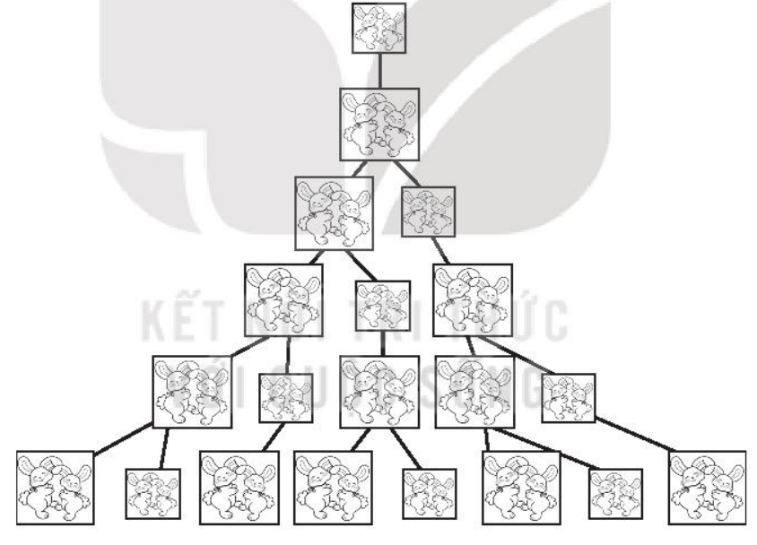

<!-- exercises 48 -->
23.1. Giả sử A = [2, 4, '5', 'Hà Nội', 'Việt Nam', 9]. Hãy cho biết kết quả các câu lệnh sau:
<!-- exercises 49 -->
a) 4 in A     b) 5 in A     c) 'Hà' in A
d) "Việt Nam" in A     e) '9' in A

23.2. Cho A là một danh sách gồm các số nguyên. Em hãy viết các câu lệnh xác định và in ra số các phần tử lớn hơn 0 của A.

23.3. Cho A là một danh sách gồm các số nguyên. Em hãy viết các câu lệnh tạo và in ra danh sách B chỉ gồm các số chẵn có trong A.

23.4. Dãy Fibonacci. Dãy số Fibonacci được xác định như sau: F₀ = 0, F₁ = 1, …, Fₙ = Fₙ₋₁ + Fₙ₋₂ (với n lớn hơn hoặc bằng 2). Điều thú vị là dãy số này nảy sinh từ một bài toán thực tế — bài toán đếm thỏ. Một cặp thỏ (gồm một thỏ đực và một thỏ cái) cứ mỗi tháng đẻ được một cặp thỏ con (cũng gồm một thỏ đực và thỏ cái); một cặp thỏ con, khi tròn 2 tháng tuổi, sau mỗi tháng đẻ ra một cặp thỏ con, và quá trình sinh nở cứ thế tiếp diễn. Hỏi sau n tháng có bao nhiêu cặp thỏ, nếu đầu năm (tháng Giêng) có một cặp thỏ sơ sinh?



Trong hình vẽ trên, quy ước: Cặp thỏ nhỏ là cặp thỏ có độ tuổi 1 tháng. Cặp thỏ to hơn là cặp thỏ có khả năng sinh sản. Quan sát hình vẽ trên ta nhận thấy: Tháng Giêng và tháng Hai: Chỉ có 1 cặp thỏ. Tháng Ba: Cặp thỏ này sẽ đẻ ra một cặp thỏ con, do đó trong tháng này có 2 cặp thỏ.
<!-- exercises 50 -->
Tháng Tư: Chỉ có cặp thỏ ban đầu sinh con nên đến thời điểm này có 3 cặp thỏ. Tháng Năm: Có hai cặp thỏ (cặp thỏ đầu và cặp thỏ được sinh ra ở tháng Ba) cùng sinh con nên ở tháng này có 2 + 3 = 5 cặp thỏ. Tháng Sáu: Có ba cặp thỏ (2 cặp thỏ đầu và cặp thỏ được sinh ra ở tháng Tư) cùng sinh con ở thời điểm này nên đến đây có 3 + 5 = 8 cặp thỏ. … Quá trình này có thể được khái quát như sau: Nếu n là số tự nhiên khác 0, gọi f(n) là số cặp thỏ có ở tháng thứ n, ta có: Với n = 1 ta được f(1) = 1. Với n = 2 ta được f(2) = 1. Với n = 3 ta được f(3) = 2. Do đó với n > 3 ta được: f(n)= f(n—1)+f(n—2). Điều đó có thể được giải thích như sau: Các cặp thỏ sinh ra ở tháng n — 1 không thể sinh con ở tháng thứ n, và ở tháng này cặp thỏ tháng thứ n —2 sinh ra một cặp thỏ con nên số cặp thỏ được sinh ra ở tháng thứ n chính là giá trị của f(n - 2). Viết chương trình nhập n từ bàn phím, tạo và in ra dãy số A bao gồm n số hạng đầu của dãy Fibonacci.

23.5. Mã hoá. Để bảo mật nội dung một văn bản khỏi những người không có thẩm quyền tình cờ nhìn thấy người ta thường mã hoá văn bản đó theo một cách nào đó. Một trong những cách đơn giản nhất là "tịnh tiến kí tự": thay thế mỗi kí tự trong văn bản bằng kí tự đứng cách nó k đơn vị trong bảng mã ASCII. Ví dụ, nếu chọn cách mã hoá các kí tự bằng kí tự đứng cách nó 3 đơn vị trong bảng mã ASCII thì bản rõ LONG sẽ trở thành ORQJ. Trong lĩnh vực mã hoá, văn bản ban đầu được gọi là bản rõ, văn bản thu được sau khi mã hoá được gọi là bản mã, số tự nhiên k được gọi là khoá. Giả sử bản rõ là một danh sách, mỗi phần tử là một kí tự trong bảng chữ cái tiếng Anh in hoa và các dấu cách, dấu phẩy, dấu chấm, dấu hai chấm, dấu nháy. Viết chương trình nhập khoá k là số tự nhiên nhỏ hơn 5, thực hiện mã hoá danh sách đó bằng phương pháp tịnh tiến kí tự và in bản mã ra màn hình. Gợi ý: Sử dụng hàm chr(<n>) để xác định kí tự có thứ tự là n và hàm ord(<kí tự>) để nhận số thứ tự của <kí tự> trong bảng mã ASCII. Ví dụ chr(65) sẽ cho kí tự A, ord(C) sẽ cho giá trị là số nguyên 67. Lưu ý: Việc yêu cầu k < 5 chỉ nhằm mục đích tất cả các kí tự trong bản mã đều hiển thị được trên màn hình.
<!-- exercises 51 -->
23.6. Giải mã. Giả sử một bản rõ được mã hoá theo phương pháp tịnh tiến kí tự với khoá k < 5 (xem Câu 23.5). Khi đó để giải mã (xác định bản rõ) ta chỉ việc đổi các kí tự tương ứng của bản mã thành kí tự đứng trước nó trong bảng mã ASCII k vị trí. Em hãy viết chương trình nhập khoá k và in ra bản rõ từ bản mã là một danh sách, trong đó mỗi phần tử là một kí tự trong bảng mã ASCII.

23.7. Cho A là một danh sách gồm các số nguyên. Em hãy viết các câu lệnh xoá tất cả các phần tử nhỏ hơn 0 trong A và in danh sách nhận được ra màn hình.

23.8. Cho dãy số [1, 2, -5, 5, 8, -8]. Em hãy viết chương trình chèn xâu "Số âm" vào sau phần tử nhỏ hơn 0 đầu tiên của dãy đã cho.

23.9. Cho danh sách A gồm tên một số địa danh du lịch của Việt Nam, ví dụ "Hồ Gươm", "Mù Cang Chải", "Sapa", "Lũng Cú", "Sầm Sơn", "Cửa Lò", "Hội An", "Phú Yên", "Nha Trang", "Mũi Né", "Bến Nhà Rồng", "Phú Quốc", ... Em hãy viết chương trình nhập vào tên một địa danh nào đó, xác định địa danh đó có trong danh sách hay chưa, nếu có thì in ra số thứ tự của địa danh ấy trong danh sách, nếu chưa có thì chèn thêm tên địa danh đó vào cuối danh sách.

23.10. Trong danh sách các địa danh du lịch có thể có địa danh xuất hiện nhiều lần. Viết chương trình để xoá bớt các trường hợp trùng lặp, sao cho mỗi địa danh trong danh sách chỉ có 1 lần.

<!-- answers 121 -->
23.1. a) True. b) False. c) False. d) True. e) False.

23.2. Các câu lệnh đó có thể viết như sau:
```python
dem = 0
for k in A:
    if k > 0:
        dem = dem + 1
print("Số các phần tử lớn hơn 0 của A = ", dem)
```

23.3. Các câu lệnh đó có thể viết như sau:
```python
B = []
for k in A:
    if k % 2 == 0:
        B.append(k)
print("Danh sách các số chẵn có trong A là: ", B)
```

23.4. Chương trình có thể viết như sau:
```python
# Dãy Fibonacci
Fibonacci = [0, 1]
n = int(input("Nhập số tự nhiên n >= 2: "))
i = 2
while i <= n:
    Fibonacci.append(Fibonacci[i - 1] + Fibonacci[i-2])
    i = i + 1
print(Fibonacci)
```
<!-- answers 122 -->
23.5. Chương trình có thể viết như sau:
```python
# Mã hoá
ban_ro = ['M','Y',' ','N','A','M','E',':',' ','L','O','N','G']
# Ví dụ minh hoạ bản rõ
khoa = int(input('Nhập số tự nhiên k < 5: '))
ban_ma = []
for kitu in ban_ro:
    ban_ma.append(chr(ord(kitu) + khoa))
print(ban_ma)
```

23.6. Tham khảo chương trình mã hoá ở Câu 23.5, dễ dàng thấy chương trình giải mã có thể viết như sau:
```python
# Giải mã
ban_ma = ['Q', ']', '$', 'R', 'E', 'Q', 'I', '>', '$', 'P', 'S', 'R', 'K']    # Bản mã nhận được trong câu 23.5 với k = 4
khoa = int(input('Nhập số tự nhiên k < 5: '))
ban_ro = []
for kitu in ban_ma:
    ban_ro.append(chr(ord(kitu) - khoa))
print(ban_ro)
```

23.7. Các câu lệnh đó có thể viết như sau:
```python
for k in A:
    if k < 0:
        A.remove(k)
print("Danh sách các số >= 0 của A = ", A)
```

23.8. Chương trình có thể viết như sau:
```python
A = [1, 2, -5, 5, 8, -8]
i = 0
while i < len(A):
    if A[i] < 0:
        A.insert(i + 1,"Số âm")
        break
    i = i + 1
print(A)
```
Lưu ý: Hãy suy nghĩ tại sao khi tìm thấy phần tử < 0 ở vị trí i thì lại dùng câu lệnh A.insert(i + 1, "Số âm") mà không phải là A.insert(i, "Số âm").
<!-- answers 123 -->
23.9. Vì phải xác định thứ tự trong danh sách nếu tìm thấy tên địa danh nên em cần duyệt danh sách đã cho theo chỉ số tương ứng của từng phần tử. Chương trình có thể viết như sau:
```python
dia_danh = ["Hồ Gươm", "Hạ Long", "Mù Cang Chải", "Lũng Cú", "Hội An", "Nha Trang", "Mũi Né", "Bến Nhà Rồng", "Phú Quốc", "Mũi Cà Mau"]
i = 0
ten = input("Địa danh cần tìm: ")
da_co = False
while i < len(dia_danh):
    if ten == dia_danh[i]:
        da_co = True
        thu_tu_diadanh = i + 1
        break
    i = i + 1
if da_co == False:
    dia_danh.append(ten)
    print("Địa danh ", ten, " chưa có. Đã được thêm vào danh sách")
else:
    print("Địa danh ", ten, "đã có ở vị trí thứ ", thu_tu_diadanh, " trong danh sách")
```
Lưu ý: Có thể thêm câu lệnh print(dia_danh) vào cuối cùng để in ra toàn bộ danh sách. Em hãy suy nghĩ tại sao khi tìm thấy tên trong danh sách ở vị trí i thì cần lưu thu_tu_diadanh = i + 1 để in ra ở cuối chương trình.

23.10. Chương trình có thể được viết như sau:
```python
# Xoá địa danh trùng lặp
dia_danh=["Hồ Gươm","Hồ Gươm","Hồ Gươm", "Hạ Long","Hồ Gươm", "Mù Cang Chải", "Hồ Gươm", "Mù Cang Chải", "Mù Cang Chải", "Mù Cang Chải"]
i = 0
while i < len(dia_danh):
    ten = dia_danh[i]
    j = i+1
    while j < len(dia_danh):
        tentieptheo = dia_danh[j]
        if ten == tentieptheo:
            dia_danh.remove(tentieptheo)
        else:
            j = j + 1
    i = i + 1
print(dia_danh)
```
