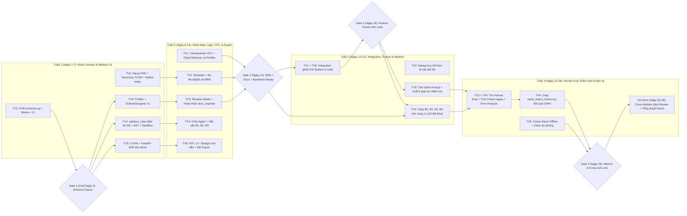

# **KẾ HOẠCH PHÂN CÔNG TRIỂN KHAI DỰ ÁN v2.0 (NHÓM 5 NGƯỜI — MỤC TIÊU 10 ĐIỂM NLP)**

**Tên đề tài:** Hệ thống Multi-Agent hỗ trợ giáo viên thiết kế hoạt động giảng dạy bám sát đề cương, giáo trình và tối ưu theo trình độ phân hóa lớp học (Môn Tin học THPT).  
**Phạm vi MVP (Phiên bản chuẩn 10 điểm):** **Chủ đề F – Giải quyết vấn đề với sự trợ giúp của máy tính** (Lập trình Python – Bộ học liệu *Chương trình GDPT 2018 + SGK + SBT/SGV Tin học 10 Kết nối tri thức với cuộc sống*, gồm 14 bài lập trình cốt lõi từ **Bài 16 đến Bài 29**), xuất kế hoạch bài dạy chuẩn **Phụ lục IV – Công văn 5512/BGDĐT-GDTrH** kèm **trích dẫn nguồn chính xác đến từng trang/mục SGK** và **3 Phiếu học tập phân hóa theo thang đo Bloom**. Hỗ trợ linh hoạt chế độ **1 tiết (45 phút – Tiết Lý thuyết hoặc Tiết Thực hành)** và **Trọn bài 2 tiết (90 phút)** đúng Phân phối chương trình THPT.  
**Thời gian thực hiện:** **4 tuần** (tổ chức phát triển song song theo mô hình *Mock-Driven + Contract-First* để triệt tiêu thời gian chờ phụ thuộc giữa 5 thành viên).

> **Lưu ý quản trị đầu dự án:** Trước khi chốt triển khai Tuần 1, Nhóm trưởng (TV1) xác nhận chính thức với Giảng viên môn Xử lý ngôn ngữ tự nhiên (NLP) về quy định sĩ số nhóm (5 thành viên) và minh bạch **bảng tỷ lệ % đóng góp (tổng = 100%)** giữa các thành viên trong hồ sơ nộp cuối kỳ.  
> 📌 **Tài liệu Thiết kế Kỹ thuật & Biểu đồ tách riêng:** Toàn bộ sơ đồ thiết kế chi tiết (Use Case, Kiến trúc LangGraph 6 node, Tuần tự E2E, Hợp đồng Pydantic Class Diagram) được lưu trữ tại file: **[Tài liệu Thiết kế Hệ thống (thietke.md)](./thietke.md)**.

---

## **1. Tổng quan Nghiệp vụ & Ca sử dụng (Use Cases)**

> 📘 **Xem biểu đồ Use Case trực quan:** Xem sơ đồ Mermaid và tương tác tác nhân chi tiết tại [Mục 1.1 - thietke.md](./thietke.md#11-biểu-đồ-use-case-tổng-thể).

Hệ thống phục vụ 3 nhóm tác nhân chính: **Giáo viên Tin học THPT** (người dùng cuối tạo giáo án và phiếu học tập), **Nhóm Nghiên cứu / Evaluator** (quản lý ingest dữ liệu và chạy benchmark ablation tự động), và **Giáo viên / Chuyên gia chấm mù** (đánh giá Human Evaluation).

### **Bảng tóm tắt 8 Use Case cốt lõi**

| Mã UC | Tên Use Case | Tác nhân chính | Đầu vào (Input) | Đầu ra nghiệm thu (Output) |
| :--- | :--- | :--- | :--- | :--- |
| **UC-01** | Cấu hình lớp học phân hóa & thời lượng | Giáo viên | Chọn Bài (16–29), `scope_mode` (45p/90p), tỷ lệ 3 nhóm (tổng 100%), phòng máy | `LessonRequest` JSON hợp lệ |
| **UC-02** | Khởi chạy sinh giáo án & theo dõi Live Trace | Giáo viên | `LessonRequest`, `bypass_hitl = False` | Dòng sự kiện SSE real-time & bản nháp hoàn chỉnh |
| **UC-03** | Duyệt & chỉnh sửa khung hoạt động (HITL) | Giáo viên | Khung 4 hoạt động đề xuất từ `Outline Planner` | Payload `POST /resume` cập nhật `AgentState` |
| **UC-04** | Đối chiếu trích dẫn SGK & 3 Phiếu học tập | Giáo viên | `LessonPlan5512` đã qua kiểm định | Giáo án minh bạch nguồn gốc (trang/mục), 0% out-of-scope |
| **UC-05** | Xuất giáo án `.docx` chuẩn Công văn 5512 | Giáo viên | `thread_id` đã hoàn tất | File `.docx` chuẩn mẫu hành chính, không lỗi font/bảng |
| **UC-06** | Ingest học liệu PDF & Taxonomy YCCĐ | Nhóm Nghiên cứu | PDF CT GDPT 2018, SGK + SBT Tin học 10 KNTT | Kho chunk sạch, index Hybrid RAG & báo cáo Recall/MRR |
| **UC-07** | Chạy Benchmark 4 mức Ablation & MLflow | Nhóm Nghiên cứu | `test_dataset.json`, `bypass_hitl = True` | Bảng & biểu đồ Ablation đối sánh 4 cấu hình trên MLflow |
| **UC-08** | Đánh giá mù Human Eval & LLM-as-a-Judge | Chuyên gia / GV | 5–6 bộ giáo án mẫu ẩn danh nguồn sinh (B2 vs B4) | Hệ số đồng thuận Cohen's κ / Spearman ρ & Error Analysis |

---

## **2. Tổng quan Kiến trúc Hệ thống Multi-Agent**

> 📘 **Xem biểu đồ Kiến trúc, Tuần tự & Lớp chi tiết:**  
> - **Biểu đồ Kiến trúc LangGraph 6 node:** Xem tại [Mục 2.1 - thietke.md](./thietke.md#21-biểu-đồ-kiến-trúc-langgraph--hybrid-rag--hitl--guardrails)  
> - **Biểu đồ Tuần tự Kịch bản Demo E2E:** Xem tại [Mục 3.1 - thietke.md](./thietke.md#31-biểu-đồ-tuần-tự-kịch-bản-e2e-ví-dụ-bài-20-câu-lệnh-lặp-for)  
> - **Biểu đồ Hợp đồng Dữ liệu Pydantic:** Xem tại [Mục 4.1 - thietke.md](./thietke.md#41-biểu-đồ-hợp-đồng-dữ-liệu-pydantic-srcschemaspy)

### **Nguyên lý Hoạt động Cốt lõi của Hệ thống:**
1. **Song song hóa Đầu vào (Parallel Input):** Khởi chạy đồng thời `Curriculum Retriever` (truy xuất học liệu qua Vietnamese Hybrid RAG với bộ lọc `bai_so <= k`) và `Class Profiler` (ánh xạ phân hóa theo thang Bloom, năng lực `NLa–NLc` và quỹ thời gian).
2. **Điểm dừng Thẩm định Người dùng (HITL Checkpointer):** `Outline Planner` tạo khung 4 hoạt động và dừng tại `interrupt_before` để giáo viên xem xét, điều chỉnh thời lượng trước khi tiêu tốn token sinh chi tiết (có cờ `bypass_hitl` cho chế độ benchmark tự động).
3. **Bộ đôi Sinh nội dung & Phản biện (Reflection Loop):** `Detail & Worksheet Designer` kết hợp chặt chẽ với cụm `Critic Hub` gồm:
   - **AST Syllabus Guard (Tất định):** Quét cây cú pháp 3 tầng cấm tuyệt đối kiến thức vượt bài học.
   - **Code Sandbox (Tất định):** Thực thi code với test case trong môi trường cô lập, kiểm soát timeout 2s và I/O.
   - **Pedagogy & Grounding Critic (LLM):** Đánh giá độ trung thực, độ phủ YCCĐ và chuẩn 5512.
4. **Vòng lặp Sửa đổi (Revision Mode):** Tự động lặp tối đa 3 vòng để hoàn thiện trước khi xuất file `.docx`.

---

## **3. Tổng quan Cơ cấu 5 Thành viên & Nhiệm vụ Chi tiết**

Để 5 người làm việc **song song ngay từ Tuần 1** mà không bị nghẽn cổ chai ở khâu ghép nối, dự án tách thành 5 module độc lập giao tiếp qua **Pydantic Schema (`src/schemas.py`)** và triển khai đầy đủ cơ chế CI tự động.

| STT | Vai trò | Trọng tâm phụ trách | Công nghệ cốt lõi |
| :--- | :--- | :--- | :--- |
| **TV1 – Minh** | **Tech Lead & Multi-Agent Orchestrator** | Kiến trúc LangGraph 6 node, `schemas.py`, Checkpointer HITL, GitHub Actions CI, quản trị Repo | Python, LangGraph, Pydantic, SQLite/MemorySaver, GitHub CI |
| **TV2 – Việt** | **Data & Agentic Hybrid RAG Engineer** | Parse PDF (CT 2018 + SGK + SBT), `yccd_taxonomy.json`, VN-BM25 + Dense + Reranker, `Recall@5`/`MRR` | Docling, `pyvi`/`underthesea`, Qdrant/Chroma, Cross-Encoder |
| **TV3 – Hòa** | **Pedagogy Domain, Prompt & Exporter Lead** | Chuẩn Công văn 5512 (4 bước, NLa–NLc, 45p/90p), `profiler.py`, `outline_planner.py`, `detail_designer.py`, `docx_exporter.py` | Prompt Engineering, Bloom Taxonomy, `python-docx` |
| **TV4 – Khánh** | **Guardrails, Critic & Evaluation Lead** | `syllabus_rules.json` (Bài 16–29), `ast_guard.py` 3 tầng, `code_sandbox.py`, Critic Agent, **Ablation 4 cấu hình** & MLflow | Python `ast`, Subprocess Sandbox, MLflow, LLM-as-a-Judge |
| **TV5 – Mạnh** | **Full-stack UI/UX, Streaming & Integration Co-lead** | FastAPI (SSE Streaming), UI phân hóa + Badge trích dẫn + Live Trace + HITL, Docker, **Đồng phụ trách Integration Tuần 3** | FastAPI, React/HTML+Tailwind (hoặc Streamlit), Docker |

---

### **Thành viên 1 (TV1 – Minh): Tech Lead & Multi-Agent Core (LangGraph)**

**Mục tiêu:** Xây dựng bộ khung điều phối luồng dữ liệu bất biến, đảm bảo điểm dừng HITL tách bạch trước khâu sinh chi tiết và vòng lặp tự sửa lỗi hội tụ ổn định.  
**Nhiệm vụ cụ thể:**

> 1. **Thiết kế Hợp đồng dữ liệu (`src/schemas.py`) trong 48h đầu (Ngày 1–2):**
   * Khóa cứng toàn bộ Pydantic models: `LessonRequest` (hỗ trợ `scope_mode`: `"45m_theory"`, `"45m_practice"`, `"90m_full"` và cờ `bypass_hitl`), `SourceCitation`, `LessonOutline`, `Activity5512` (tách rõ 4 trường `step1_transfer` → `step4_conclude`), `WorksheetItem` (tách riêng `starter_code` cho HS và `solution_code` + `test_cases` cho kiểm định), `CriticReport` và `AgentState`.
> 2. **Khởi tạo Repo, Mock Pipeline & CI tự động:**
   * Tạo `tests/mocks/` (mock JSON cho từng node và mock SSE stream) để TV3, TV4, TV5 code độc lập từ Ngày 3.
   * Cấu hình `.github/workflows/ci.yml` tự động chạy `pytest` kiểm tra Schema & AST Guard trên mọi Pull Request để giảm tải review thủ công.
> 3. **Xây dựng đồ thị LangGraph 6 node (`src/graph/workflow.py`):**
   * Chạy song song 2 nhánh đầu vào: `Curriculum Retriever` (TV2) và `Class Profiler` (TV3).
   * Hội tụ vào `Outline Planner` (TV3) → rẽ nhánh theo `bypass_hitl`: dừng tại `interrupt_before` (HITL) khi chạy UI, hoặc đi thẳng khi chạy Benchmark hàng loạt.
   * Nối sang `Detail & Worksheet Designer` (TV3) → `Critic & Guardrails` (TV4).
   * Cấu hình Conditional Edge: Nếu chưa đạt chuẩn và `iteration < 3` → quay lại `Detail Designer` ở **Revision Mode** kèm `revision_instructions`; nếu đạt hoặc `iteration == 3` → đi tiếp sang Export.
> 4. **Cài đặt Checkpointer HITL:** Dùng `SqliteSaver` / `MemorySaver` lưu trạng thái `thread_id`, xử lý API cập nhật state khi GV chỉnh sửa khung hoạt động và resume chính xác.
> 5. **Điều phối tích hợp cùng TV5 (Integration Co-lead):** Dẫn dắt kiến trúc và review các điểm ghép nối trọng yếu.

**Sản phẩm bàn giao (Deliverables):** `src/schemas.py`, `tests/mocks/`, `.github/workflows/ci.yml`, `src/graph/workflow.py`, tài liệu đặc tả `AgentState`.  
**Tiêu chí nghiệm thu (DoD):** Đồ thị 6 node chạy thông suốt cả 2 chế độ (`bypass_hitl=False` dừng/tiếp tục đúng state; `bypass_hitl=True` chạy batch không treo), xử lý thành công vòng lặp tự sửa lỗi và mọi PR đều qua CI `pytest`.

---

### **Thành viên 2 (TV2 – Việt): Data & Agentic Hybrid RAG Engineer**

**Mục tiêu:** Bóc tách học liệu chuẩn (không vỡ bảng biểu, không mất thụt lề code Python), chuẩn hóa hệ thống mã YCCĐ và đảm bảo truy hồi chính xác theo cấu trúc bài học tích lũy.  
**Nhiệm vụ cụ thể:**

> 1. **Thu thập & Chuẩn hóa bộ học liệu nguồn (Chủ đề F – Lớp 10):**
   * PDF *Chương trình GDPT môn Tin học 2018 (Thông tư 32/2018/TT-BGDĐT)* — phần Chủ đề F lớp 10 và hệ thống năng lực `NLa–NLe`.
   * PDF *SGK & SBT/SGV Tin học 10 (Kết nối tri thức)* — trọn bộ 14 bài lập trình Python từ **Bài 16** (*Ngôn ngữ lập trình bậc cao và Python*) đến **Bài 29** (*Nhận biết lỗi chương trình*).
   * Phối hợp TV3 lập `data/yccd_taxonomy.json` ánh xạ YCCĐ Thông tư 32 vào mã chuẩn cho từng bài (ví dụ `F10.B19.YC1`, `F10.B20.YC1`) làm Ground Truth cho RAG & Critic.
> 2. **Layout-aware Parsing:** Dùng **Docling** (kết hợp hậu xử lý Markdown) chuyển đổi PDF sang Markdown, bảo toàn 100% bảng biểu, số trang gốc (`page_number`) và khối code Python.
> 3. **Chunking & Gắn Metadata phân cấp:** Chia văn bản theo cấu trúc (`doc_type`: `ct2018`/`sgk`/`sbt`, `chuong`, `bai_so`, `ten_bai`, `muc`, `page_number`, `loai_noi_dung`: lý thuyết / ví dụ / bài tập / YCCĐ).
> 4. **Xây dựng Vietnamese Hybrid RAG + Reranker (`src/rag/` & `src/agents/retriever.py`):**
   * Tiền xử lý tách từ tiếng Việt (`pyvi` hoặc `underthesea`) cho chỉ mục **BM25** để bắt chính xác thuật ngữ ghép (*câu lệnh rẽ nhánh, xâu kí tự, danh sách, chương trình con*).
   * Kết hợp **BM25 + Dense Vector Search** (`ChromaDB`/`Qdrant`) với bộ lọc metadata **`bai_so <= target_bai`** (cho phép kế thừa kiến thức/bài tập từ các bài đã học trước đó, đồng thời **cấm tuyệt đối** kéo kiến thức của bài `> target_bai`).
   * Đưa qua **Cross-Encoder Reranker** → Agentic **Document Grader** (kiểm tra đủ YCCĐ + ví dụ) và **Query Rewriter** nếu thiếu ngữ cảnh.
> 5. **Đánh giá định lượng tầng Truy hồi (`eval/retrieval_eval.py`):** Tạo 30–50 câu truy vấn chuẩn kèm nhãn trang/bài đúng để đo **`Recall@5`** và **`MRR`** (so sánh BM25 thuần vs Dense thuần vs Hybrid + VN-Segmentation + Reranker).

**Sản phẩm bàn giao (Deliverables):** `data/processed/`, `data/yccd_taxonomy.json`, `src/rag/ingest.py`, `src/agents/retriever.py`, `eval/retrieval_eval.py`.  
**Tiêu chí nghiệm thu (DoD):** Đạt `Recall@5 >= 0.90` và `MRR >= 0.85` trên tập truy vấn chuẩn; không bao giờ trả về chunk có `bai_so > target_bai`; trích xuất đúng 100% số trang và mã YCCĐ.

---

### **Thành viên 3 (TV3 – Hòa): Pedagogy Domain, Prompt Engineering & Exporter Lead**

**Mục tiêu:** Chuẩn hóa tri thức sư phạm Việt Nam theo Công văn 5512 vào hệ thống prompt tách đôi (Khung – Chi tiết), tạo phân hóa sắc nét 3 bậc Bloom và xuất file `.docx` chuẩn hành chính.  
**Nhiệm vụ cụ thể:**

> 1. **Xây dựng Node Class Profiler (`src/agents/profiler.py`):** Nhận đầu vào tỷ lệ phân hóa lớp học (ví dụ 25% Cơ bản – 50% Đạt chuẩn – 25% Nâng cao), `scope_mode` (`45m_theory` / `45m_practice` / `90m_full`) và điều kiện phòng máy; ánh xạ thành ma trận mục tiêu **Thang Bloom**, mã năng lực Tin học (`NLa, NLb, NLc`) và bảng phân bổ phút cho từng hoạt động.
> 2. **Xây dựng Node Outline Planner (`src/agents/outline_planner.py`):** Sinh nhanh khung 4 hoạt động chuẩn 5512, phân bổ phút (tổng đúng 45p hoặc 90p) và định hướng mục tiêu 3 phiếu học tập để phục vụ điểm dừng HITL tiết kiệm token.
> 3. **Thiết kế Prompt & Few-shot cho Detail & Worksheet Designer (`src/agents/detail_designer.py`):**
   * Tuân thủ nghiêm ngặt **Phụ lục IV – Công văn 5512**:
     * **Phần I. Mục tiêu:** Tách đủ *Kiến thức*, *Năng lực* (Năng lực chung + **Năng lực Tin học đặc thù `NLa–NLc`**), *Phẩm chất*.
     * **Phần II. Thiết bị dạy học & học liệu:** Phòng máy, Python IDE, SGK/SBT, 3 phiếu học tập.
     * **Phần III. Tiến trình dạy học (4 hoạt động):** *Khởi động – Hình thành kiến thức – Luyện tập – Vận dụng*, mỗi hoạt động đủ 4 mục (*Mục tiêu, Nội dung, Sản phẩm, Tổ chức thực hiện*), trong đó mục *Tổ chức thực hiện* bắt buộc đủ **4 bước tường minh** (*Chuyển giao – Thực hiện – Báo cáo, thảo luận – Kết luận, nhận định*).
   * Bắt buộc gắn `citations` (`SourceCitation`) vào các hoạt động lấy kiến thức/bài tập từ RAG.
   * Sinh 3 Phiếu học tập phân hóa tách riêng `starter_code` (phần khung in cho HS, có thể có chỗ trống `___` ở nhóm Cơ bản) và `solution_code` + `test_cases` (code chạy được với `input()` rỗng để kiểm thử Sandbox):
     * *Nhóm Cơ bản (Nhớ/Hiểu):* Đọc hiểu code, bảng trace, điền khuyết 1–2 dòng.
     * *Nhóm Đạt chuẩn (Vận dụng):* Tự viết chương trình giải bài toán chuẩn SGK.
     * *Nhóm Nâng cao (Phân tích/Sáng tạo):* Xử lý trường hợp biên (`edge cases`), tìm/sửa lỗi logic hoặc tối ưu thuật toán trong giới hạn cú pháp bài học.
   * Xây dựng **Revision Mode**: Nhận danh sách lỗi cụ thể từ AST/Sandbox/Critic và chỉ sửa phần bị lỗi, giữ nguyên cấu trúc đã đạt.
> 4. **Xây dựng Module Xuất Word (`src/utils/docx_exporter.py`):** Hoàn thiện ngay trong Tuần 2 trên mock JSON, xuất đầy đủ Phần I–III (bảng 2 cột *Hoạt động của GV - HS* \| *Dự kiến sản phẩm*, khung code monospace có nền xám nhạt, trích dẫn trang SGK) và Phụ lục 3 Phiếu học tập (chỉ in `starter_code` ở đề bài, phần đáp án/test case đặt ở cuối phụ lục dành cho GV).

**Sản phẩm bàn giao (Deliverables):** `src/agents/profiler.py`, `src/agents/outline_planner.py`, `src/agents/detail_designer.py`, `src/prompts/`, `src/utils/docx_exporter.py`.  
**Tiêu chí nghiệm thu (DoD):** Giáo án đủ Phần I–III & 4 bước CV 5512, tổng thời lượng khớp 100% (`45` hoặc `90` phút), `solution_code` tuân thủ quy ước `input()` rỗng, xuất `.docx` sạch đẹp không vỡ bảng hay lỗi font tiếng Việt.

---

### **Thành viên 4 (TV4 – Khánh): Deterministic Guardrails, Critic Agent & Evaluation Lead**

**Mục tiêu:** Tạo ra điểm khác biệt cốt lõi ("Killer Feature") để khóa chặt điểm 10 trước hội đồng bằng kiểm định code tất định 3 tầng và bộ thực nghiệm Ablation 4 cấu hình chuẩn khoa học.  
**Nhiệm vụ cụ thể:**

> 1. **Xây dựng Bảng quy ước phạm vi cú pháp 3 tầng (`data/syllabus_rules.json`):** Bám sát chính xác thứ tự 14 bài của **SGK Tin học 10 – Kết nối tri thức**:
   * **Bài 16–18:** Giới thiệu Python, Biến & lệnh gán, Lệnh vào ra (`print`, `input`, `int`, `float`).
   * **Bài 19:** Câu lệnh điều kiện `if` (`If`, phép so sánh, logic `and/or/not`) — *chưa được dùng `for`, `while`, `list`, `def`*.
   * **Bài 20:** Câu lệnh lặp `for` (cho phép `For`, `Range`, `If`; **cấm** `While`, `ListComp`, `FunctionDef`, `Lambda`, đồng thời cấm các built-in/method chưa học như `enumerate`, `zip`, `sum`, `sorted`, `.append()`, `.sort()`).
   * **Bài 21:** Câu lệnh lặp `while` (mở khóa `While`, `Break`, `Continue`).
   * **Bài 22–25:** Kiểu dữ liệu danh sách `list` & xâu kí tự `str`.
   * **Bài 26–29:** Hàm `def`, Tham số & phạm vi biến, Kiểm thử & gỡ lỗi.
> 2. **Xây dựng AST Syllabus Guard (`src/tools/ast_guard.py`):**
   * Chỉ quét trên **`solution_code`** (tránh lỗi `SyntaxError` giả trên `starter_code` điền khuyết `___` của phiếu Cơ bản).
   * Kiểm tra đầy đủ 3 tầng: `allowed_ast_nodes`, `allowed_builtins`, `allowed_methods`/`forbidden_imports`. Trả về thông báo lỗi chính xác đến từng dòng và tên phiếu (ví dụ: *"Phiếu Nâng cao – dòng 4 dùng `ListComp` hoặc `enumerate()` vượt phạm vi Bài 20"*).
> 3. **Xây dựng Code Sandbox Verifier (`src/tools/code_sandbox.py`):**
   * Chạy kiểm thử toàn bộ `solution_code` với `test_cases` trong `subprocess` cô lập (`timeout = 2s`, ép `PYTHONIOENCODING=utf-8`, chặn import `os`, `sys`, `subprocess`, `socket`, `open`).
   * Chuẩn hóa `.strip()` từng dòng đầu ra và kiểm soát prompt dùng `input()` rỗng để đối chiếu chính xác `expected_stdout`.
> 4. **Xây dựng Pedagogy & Grounding Critic (`src/agents/critic.py`):**
   * Kết hợp đầu ra tất định từ `ast_guard` + `code_sandbox` với 1 lượt chấm LLM trên 5 trục: **Faithfulness** (không bịa ngoài tài liệu RAG), **Citation Precision**, **YCCĐ Coverage**, **Khớp thời lượng 45p/90p**, và **Phân hóa Bloom**.
> 5. **Thực nghiệm Ablation Study 4 cấu hình, Human Eval & Kiểm toán số liệu (`eval/`):**
   * Thiết lập `eval/test_dataset.json` (10–15 bài × nhiều cấu hình phân hóa) và khóa **cùng 1 base LLM (`temperature=0`, `bypass_hitl=True`)** cho cả 4 cấu hình:
     * **B1 (Baseline 1):** Zero-shot Single LLM (không RAG).
     * **B2 (Baseline 2):** Single-Agent + Hybrid RAG.
     * **B3 (Ablation):** Multi-Agent + Hybrid RAG + **LLM Critic thuần (tắt AST & Sandbox)** — chứng minh LLM tự bắt lỗi cú pháp vượt cấp và lỗi runtime vẫn bị sót.
     * **B4 (Full System):** Multi-Agent + Hybrid RAG + **AST Guard + Code Sandbox + Pedagogy Critic**.
   * Log toàn bộ chỉ số lên **MLflow**: `Recall@5`, `MRR`, `Faithfulness`, `Citation Precision`, `YCCĐ Coverage`, `Out-of-Scope Violation Rate`, `Code Pass Rate`, `Differentiation Score`, `Latency`, `Token Cost`.
   * Phối hợp TV3 tổ chức **Human Evaluation** (chấm mù 5–6 giáo án mẫu), tính hệ số đồng thuận **Cohen's κ / Spearman ρ** với LLM-as-a-Judge và viết phần **Error Analysis**.
   * Viết `eval/verify_report_metrics.py` kiểm toán tự động để mọi con số trong báo cáo/slide khớp 100% file log MLflow/JSON.

**Sản phẩm bàn giao (Deliverables):** `data/syllabus_rules.json`, `src/tools/ast_guard.py`, `src/tools/code_sandbox.py`, `src/agents/critic.py`, `eval/baselines.py`, `eval/run_benchmark.py`, `eval/verify_report_metrics.py`.  
**Tiêu chí nghiệm thu (DoD):** AST Guard bắt 100% lỗi vượt cú pháp 3 tầng trên bộ unit test; B4 đạt `Out-of-Scope Rate = 0%`, `Code Pass Rate = 100%`, vượt trội rõ rệt và tách biệt được đóng góp so với B1, B2, B3; script đối soát số liệu PASS 100%.

---

### **Thành viên 5 (TV5 – Mạnh): Full-stack UI/UX, Streaming & Integration Co-lead**

**Mục tiêu:** Xây dựng giao diện trực quan phô diễn sức mạnh giải thích (Live Trace, trích dẫn SGK, HITL), đồng thời chia tải ghép hệ thống ở Tuần 3 cùng TV1 để đảm bảo tiến độ.  
**Nhiệm vụ cụ thể:**

> 1. **Xây dựng Backend API (`src/api/main.py`) bằng FastAPI:**
   * `POST /api/lesson/start`: Nhận `LessonRequest`, chạy LangGraph và stream tiến độ từng node qua **SSE**.
   * `POST /api/lesson/resume`: Nhận chỉnh sửa khung hoạt động từ giáo viên tại điểm dừng HITL để chạy tiếp `Detail Designer <-> Critic`.
   * `GET /api/lesson/{thread_id}/export`: Gọi `docx_exporter.py` trả về file `.docx`.
> 2. **Xây dựng Giao diện Giáo viên (`frontend/`):**
   * **Bảng điều khiển phân hóa:** Chọn Bài (16–29), chọn chế độ thời lượng (`45p Lý thuyết` / `45p Thực hành` / `90p Trọn bài`), 3 thanh trượt phân hóa tự cân bằng 100%, ghi chú phòng máy.
   * **Màn hình Live Execution Trace:** Hiển thị trạng thái từng Agent; làm nổi bật **thẻ đỏ** khi `AST Guard` bắt lỗi vượt chương trình hoặc `Sandbox` báo lỗi test case, chuyển sang **thẻ xanh** khi `Designer` tự sửa thành công.
   * **Màn hình duyệt HITL:** Cho phép sửa nhanh tên hoạt động, thời lượng từng phần trên khung bài dạy và bấm *"Xác nhận & Sinh chi tiết"*.
   * **Trình xem Giáo án & Trích dẫn:** Tab Giáo án 5512 gắn **Badge trích dẫn nguồn SGK** (hiển thị trang/mục/đoạn trích gốc khi click) + 3 tab Phiếu học tập (hiển thị `starter_code`, nút bật/tắt đáp án `solution_code` & kết quả Sandbox) + nút tải `.docx`.
> 3. **Đồng phụ trách Tích hợp Tuần 3 (Integration Co-lead):** Phối hợp trực tiếp cùng TV1 trong Ngày 15–18 để thay mock bằng 4 Agent thật, debug luồng SSE & HITL `/resume`.
> 4. **Đóng gói & Demo dự phòng:** Viết `Dockerfile` / `docker-compose.yml`, lưu sẵn cache một phiên chạy chuẩn (có sẵn tình huống AST bắt lỗi → sửa lại thành công) + video quay màn hình dự phòng mất mạng/rate-limit.

**Sản phẩm bàn giao (Deliverables):** `src/api/`, `frontend/`, `docker-compose.yml`, cache demo offline & video dự phòng.  
**Tiêu chí nghiệm thu (DoD):** Demo chạy mượt không lag, hiển thị đầy đủ Live Trace vòng lặp Critic + Badge trích dẫn SGK, thao tác HITL cập nhật đúng kết quả và tải `.docx` thành công từ trình duyệt.

---

## **4. Cấu trúc Mã nguồn Chung (Repository Structure)**

```text
multi-agent-cs-lesson-planner/
├── .github/
│   └── workflows/
│       └── ci.yml                 # (TV1) Auto-run pytest Schema & AST Guard trên mọi PR
├── data/
│   ├── raw_pdfs/                  # (TV2) PDF CT GDPT 2018 (TT 32) & SGK/SBT Tin học 10 KNTT
│   ├── processed/                 # (TV2) Markdown sạch + metadata JSON (có page_number)
│   ├── yccd_taxonomy.json         # (TV2 + TV3) Chuẩn hóa mã YCCĐ & NLa-NLe theo Bài 16-29
│   └── syllabus_rules.json        # (TV4) Quy ước 3 tầng (AST, Built-ins, Methods) Bài 16-29
├── src/
│   ├── schemas.py                 # (TV1) Pydantic models chung (Contract Freeze sau 48h)
│   ├── rag/
│   │   ├── ingest.py              # (TV2) Docling parser, VN segmentation, Vector + BM25 index
│   │   └── hybrid_search.py       # (TV2) Hybrid Search (bai_so <= k) + Cross-Encoder Reranker
│   ├── tools/
│   │   ├── ast_guard.py           # (TV4) Kiểm định cú pháp 3 tầng trên solution_code
│   │   └── code_sandbox.py        # (TV4) Chạy kiểm thử solution_code & test_cases (UTF-8, 2s)
│   ├── prompts/                   # (TV3) System prompts chuẩn CV 5512, Bloom & Revision Mode
│   ├── agents/
│   │   ├── retriever.py           # (TV2) Node truy xuất đề cương + Grader + Query Rewriter
│   │   ├── profiler.py            # (TV3) Node phân tích lớp học (45p/90p) & ma trận Bloom
│   │   ├── outline_planner.py     # (TV3) Node sinh khung 4 hoạt động phục vụ HITL
│   │   ├── detail_designer.py     # (TV3) Node sinh chi tiết 5512 + 3 phiếu + Revision Mode
│   │   └── critic.py              # (TV4) Node kiểm định tổng hợp (AST + Sandbox + LLM Critic)
│   ├── graph/
│   │   └── workflow.py            # (TV1) StateGraph 6 node, HITL Checkpointer, Reflection Loop
│   ├── utils/
│   │   └── docx_exporter.py       # (TV3) Xuất file Word chuẩn Phụ lục IV – CV 5512
│   └── api/
│       └── main.py                # (TV5) FastAPI SSE Streaming, HITL resume & DOCX export
├── frontend/                      # (TV5) Web UI (Slider 100%, Live Trace, Citations, HITL)
├── eval/
│   ├── retrieval_queries.json     # (TV2) 30-50 câu truy vấn chuẩn đánh giá Recall@5 & MRR
│   ├── retrieval_eval.py          # (TV2) Script đo hiệu năng tầng Hybrid RAG
│   ├── test_dataset.json          # (TV4 + TV2) 10-15 bài học x hồ sơ lớp mẫu
│   ├── baselines.py               # (TV4) Code chạy B1 (Zero-shot), B2 (Single+RAG), B3 (No AST/Sandbox)
│   ├── run_benchmark.py           # (TV4) Script chạy Ablation 4 mức & log MLflow
│   └── verify_report_metrics.py   # (TV4) Script kiểm toán số liệu báo cáo khớp 100% MLflow/JSON
├── tests/
│   ├── mocks/                     # (TV1) Mock JSON cho các node & mock SSE stream
│   ├── test_schemas.py            # (TV1) Unit test Pydantic contract
│   ├── test_ast_guard.py          # (TV4) Unit test bắt lỗi 3 tầng vượt chương trình
│   └── test_sandbox.py            # (TV4) Unit test cô lập, timeout & UTF-8 I/O
├── docker-compose.yml             # (TV5)
└── README.md
```

---

## **5. Lộ trình Triển khai 4 Tuần & Các Cổng Bàn giao (Sprint Plan)**

### **5.1. Sơ đồ Đường găng Phối hợp & 4 Cổng Bàn giao (Handoff Gates)**



### **5.2. Chiến lược cắt phụ thuộc (Decoupling)**

> * **Khóa Contract trong 48 giờ đầu (Ngày 1–2):** TV1 chốt `src/schemas.py`, `tests/mocks/` và CI `pytest`. Trong 48h đầu, TV2–TV5 làm các hạng mục thuần dữ liệu/nghiệp vụ không cần đợi schema (gom PDF, lập `yccd_taxonomy.json`, lập `syllabus_rules.json` đúng mục lục Bài 16–29, dựng UI tĩnh).
> * **Tách `Outline_Planner` trước HITL & Đẩy `docx_exporter.py` lên Tuần 2:** Giúp tiết kiệm token khi dừng HITL và phát hiện sớm lỗi font tiếng Việt/bảng 2 cột CV 5512 ngay trên mock JSON.
> * **Đồng phụ trách Tích hợp Tuần 3 (TV1 + TV5):** Chia tải giai đoạn Ngày 15–18 để tránh dồn tắc cho TV1, đồng thời TV4 chạy trước `B1, B2` song song đầu Tuần 3 ngay khi có `data/processed/`.
> * **Chạy Human Eval & Kiểm toán số liệu khép kín:** Xuất 5–6 giáo án mẫu ngay sau Feature Freeze (Ngày 18) để kịp tổng hợp độ đồng thuận Human Eval đầu Tuần 4.

### **5.3. Kế hoạch phân công song song theo từng tuần**

| Giai đoạn | Mục tiêu chính (Milestone) | Công việc song song của 5 thành viên |
| :--- | :--- | :--- |
| **Tuần 1** (Ngày 1–7) Khóa Contract & Module lõi | Chốt `schemas.py` + Mock hết Ngày 2; từng module chạy độc lập & qua CI hết Ngày 7. | **TV1:** Ngày 1–2 dựng repo, chốt `schemas.py`, `mocks/`, CI `pytest`; Ngày 3–7 dựng `workflow.py` 6 node chạy trên mock.<br>**TV2:** Ngày 1–2 gom đủ PDF CT 2018 + SGK/SBT Tin 10 (Bài 16–29) + phối hợp TV3 chốt `yccd_taxonomy.json`; Ngày 3–7 Docling parse sang `data/processed/`, tách từ VN & index BM25 + Vector.<br>**TV3:** Ngày 1–2 chốt mẫu Phụ lục IV CV 5512 (4 bước + `NLa–NLc`) & Bloom; Ngày 3–7 code `profiler.py`, `outline_planner.py`, `detail_designer.py` v1 trên mock.<br>**TV4:** Ngày 1–2 lập xong `syllabus_rules.json` 3 tầng đúng thứ tự Bài 16–29; Ngày 3–7 hoàn thiện `ast_guard.py`, `code_sandbox.py` (chỉ quét `solution_code`, UTF-8, `input()` rỗng) + unit test 100%.<br>**TV5:** Ngày 1–2 dựng UI tĩnh (chọn 45p/90p, slider 100%, Live Trace, tab 5512 + 3 phiếu); Ngày 3–7 dựng FastAPI SSE nối mock của TV1. |
| **Tuần 2** (Ngày 8–14) Hoàn thiện Logic, HITL & Export | Hoàn thiện 100% logic module; đo xong `Recall@5`/`MRR`; HITL & tải `.docx` mượt trên mock. | **TV1:** Cài Checkpointer `interrupt_before` trước `Detail Designer`, hỗ trợ cờ `bypass_hitl`, chốt payload `/resume` với TV5; ghép thử `Retriever || Profiler → Outline_Planner`.<br>**TV2:** Hoàn thiện bộ lọc `bai_so <= k`, Cross-Encoder Reranker, Grader & Query Rewriter; chạy `retrieval_eval.py` chốt `Recall@5`/`MRR`; bàn giao `test_dataset.json` với TV4.<br>**TV3:** Hoàn thiện **Revision Mode** cho `detail_designer.py`; hoàn thiện 100% `docx_exporter.py` (đủ Phần I–III + bảng 2 cột + Phụ lục 3 phiếu) test trên mock.<br>**TV4:** Hoàn thiện `critic.py` (AST + Sandbox + LLM 5 trục); viết sẵn `baselines.py` (`B1, B2, B3`) và khung `run_benchmark.py` (MLflow + LLM-as-a-Judge).<br>**TV5:** Hoàn thiện màn hình HITL (sửa phút/tên hoạt động), Badge trích dẫn trang SGK trên UI, và nối `/export` với `docx_exporter.py` thật. |
| **Tuần 3** (Ngày 15–21) **Integration**, Freeze & Ablation | Chạy thông suốt Full System 6 node; **Feature Freeze** (Ngày 18); hoàn tất Ablation 4 cấu hình trên MLflow. | **TV1 + TV5 (Co-lead):** Ngày 15–17 thay toàn bộ mock trong `workflow.py` và SSE API bằng 5 node thật, debug vòng lặp `Detail Designer <-> Critic` và HITL `/resume`; chốt `main` (**Feature Freeze**) hết Ngày 18.<br>**TV2:** Debug lỗi truy hồi thực tế (đặc biệt bài dài như Danh sách/Hàm), tinh chỉnh Query Rewriter.<br>**TV3:** Tinh chỉnh prompt theo lỗi thực tế từ Critic; cuối tuần xuất 5–6 cặp giáo án ẩn danh gửi chấm mù (**Human Eval**).<br>**TV4:** Ngày 15–17 chạy trước `B1, B2` trên cùng base LLM (`temperature=0`); Ngày 18–21 chạy `B3` (No AST/Sandbox) & `B4` (Full System), xuất bảng so sánh đủ 10 chỉ số lên MLflow.<br>**TV5 (UI/Docker):** Hoàn thiện hiệu ứng Live Trace (thẻ đỏ AST → thẻ xanh sửa xong) và đóng gói `docker-compose.yml`. |
| **Tuần 4** (Ngày 22–28) Chốt Thực nghiệm, Kiểm toán & Bảo vệ | Đủ số liệu Ablation + đồng thuận Human Eval + kiểm toán 100% + **Vấn đáp chéo chống điểm liệt**. | **TV1:** Viết phần *Kiến trúc Multi-Agent, LangGraph & HITL*; điều phối buổi **Cross-Module Q&A Review (Ngày 25–26)**.<br>**TV2:** Viết phần *Dữ liệu, Docling, VN-Hybrid RAG & Retrieval Eval*; hỗ trợ phân tích lỗi truy hồi.<br>**TV3:** Thu kết quả Human Eval (Ngày 22–23); viết phần *Nghiệp vụ CV 5512, Phân hóa Bloom & Đánh giá sư phạm*; xuất bộ `.docx` mẫu đính kèm báo cáo.<br>**TV4:** Tính **Cohen's κ / Spearman ρ** giữa Human Eval & LLM-as-a-Judge; viết phần *Guardrails, Ablation 4 mức & Error Analysis*; chạy `verify_report_metrics.py` đối soát 100% số liệu báo cáo.<br>**TV5:** Tạo **cache 1 phiên chạy chuẩn** + quay video demo dự phòng; viết phần *Hệ thống API, Streaming & Giao diện*.<br>**Cả nhóm (Ngày 25–28):** Họp **Cross-Module Q&A 60 phút** (bảo đảm mọi thành viên giải thích trôi chảy code của nhau), ghép báo cáo, hoàn thiện slide và tổng duyệt demo. |

### **5.4. Các mốc bàn giao cứng (Handoff Gates)**

| Mốc thời gian | Sản phẩm bàn giao bắt buộc | Thành viên & luồng được mở khóa |
| :--- | :--- | :--- |
| **Gate 1 — Cuối Ngày 2 (Tuần 1)** | TV1 chốt `src/schemas.py` + `tests/mocks/` + CI; TV2+TV3 chốt `yccd_taxonomy.json` | Mở khóa TV3, TV4, TV5 code song song trên cùng hợp đồng dữ liệu. |
| **Gate 2 — Cuối Tuần 2 (Ngày 14)** | TV2 chốt `data/processed/` + báo cáo `Recall@5`/`MRR`; TV3 chốt `docx_exporter.py`; TV4 xong `B1–B3` | TV4 chạy ngay `B1, B2` đầu Tuần 3; TV5 nối xong luồng tải `.docx` và UI trích dẫn. |
| **Gate 3 — Giữa Tuần 3 (Ngày 18)** | **Feature Freeze** Full System 6 node trên nhánh `main` | TV4 chạy benchmark `B3, B4` trên cùng LLM; TV3 xuất bộ giáo án mẫu gửi chấm Human Eval. |
| **Gate 4 — Ngày 25 (Tuần 4)** | Chốt số liệu MLflow + Cohen's κ + `verify_report_metrics.py` PASS + Cache Demo | Cả nhóm chốt báo cáo, slide, thi **Cross-Module Q&A Review** và tổng duyệt Demo. |

---

## **6. Quy tắc Phối hợp, Quản trị Rủi ro & Chống Điểm liệt Vấn đáp**

> 1. **Nguyên tắc "Schema Freeze sau 48 giờ":** Khóa cứng cấu trúc cốt lõi trong `src/schemas.py` cuối Ngày 2. Từ Tuần 2 trở đi chỉ được bổ sung trường tùy chọn (`Optional`), cấm breaking change nếu chưa có sự đồng thuận của cả 5 thành viên và CI pass.
> 2. **Nhánh Git, PR & CI tự động:** Không push trực tiếp vào `main`. Mỗi thành viên làm trên nhánh riêng (`feat/rag-tv2`, `feat/ast-guard-tv4`, `feat/ui-tv5`...); PR chỉ được merge khi GitHub Actions `pytest` báo xanh. Nhịp merge định kỳ tối Thứ 4 & Chủ nhật; Tuần 3 (Ngày 15–17) merge liên tục theo cặp TV1 + TV5.
> 3. **Quản lý chi phí API & Tính công bằng Thực nghiệm:** 2 tuần đầu dùng model nhanh/rẻ (Gemini Flash / Groq / Ollama) để debug luồng. Khi chạy Ablation chính thức ở Tuần 3, **bắt buộc khóa cùng 1 base LLM, cùng `temperature=0`, cùng `test_dataset.json`** cho cả 4 cấu hình `B1–B4` và log token cost trên MLflow.
> 4. **Họp Standup 15 phút (3 buổi/tuần — Thứ 2, Thứ 4, Thứ 6):** Chỉ trả lời đúng 3 câu hỏi: *Đã xong phần nào? Điểm giao tiếp nào đang vướng? 2 ngày tới bàn giao file gì?*
> 5. **Đồng phụ trách Tích hợp Tuần 3 (TV1 + TV5):** Chia sẻ quyền merge & debug SSE/LangGraph trong Ngày 15–18 để tránh nút cổ chai cá nhân khi trùng cao điểm các môn học khác.
> 6. **Chống điểm liệt vấn đáp & Kiểm toán số liệu:** Tổ chức **Cross-Module Q&A 60 phút** vào Ngày 25–26 (mỗi thành viên phải trình bày được cơ chế Hybrid RAG, LangGraph HITL, AST 3 tầng và công thức tính metric của cả nhóm) và chạy `verify_report_metrics.py` để bảo đảm **0% sai lệch** giữa báo cáo/slide và log thực nghiệm.

---

## **7. Ma trận Đối chiếu Tiêu chí 10 Điểm & Kịch bản Phản biện Hội đồng**

| Câu hỏi phản biện trọng tâm từ Hội đồng NLP | Lỗ hổng nếu giữ kế hoạch cũ | Giải pháp & Minh chứng thực nghiệm của Kế hoạch v2.0 |
| :--- | :--- | :--- |
| **1. Một bài SGK chỉ dài 3–4 trang (~2.000 token), nhét thẳng vào prompt là xong, cần gì Hybrid RAG + VectorDB?** | Lọc cứng `bai_so == k` khiến RAG mất tác dụng, giống đồ án Web gọi LLM đơn thuần. | Kho RAG gộp **CT GDPT 2018 + SGK + SBT/SGV**; lọc **`bai_so <= k`** để kế thừa kiến thức/bài tập các bài trước mà chặn tuyệt đối bài chưa học; có **tách từ tiếng Việt cho BM25 + Cross-Encoder Reranker + Query Rewriter** kèm số liệu chứng minh `Recall@5` & `MRR` vượt trội so với BM25/Dense đơn lẻ. |
| **2. Kết quả `Out-of-Scope = 0%` và `Code Pass = 100%` là nhờ Multi-Agent, nhờ LLM Critic hay chỉ nhờ hàm `ast.parse`?** | Chỉ so `B2 (Single+RAG)` với `Full System` nên bị gộp biến số, không tách được đóng góp của từng thành phần. | Chạy **Ablation 4 cấu hình** (`B1` Zero-shot, `B2` Single+RAG, `B3` Multi-Agent + **LLM Critic thuần không AST/Sandbox**, `B4` Full System). So sánh `B3` vs `B4` chứng minh LLM tự kiểm định vẫn sót lỗi cú pháp vượt cấp và lỗi runtime, khẳng định giá trị kết hợp **Neuro-Symbolic (LLM + AST/Sandbox)**. |
| **3. BM25 xử lý tiếng Việt thế nào? Sinh ngữ cảnh có trích xuất nguồn chính xác không?** | Không tách từ tiếng Việt và thiếu chỉ số đo `Faithfulness` / `Citation Precision`. | Tiền xử lý **Word Segmentation (`pyvi`/`underthesea`)** trước khi đánh index BM25; schema bắt buộc `SourceCitation` đến tận số trang/mục; Critic & Benchmark đo đầy đủ `Faithfulness` và `Citation Precision` + UI hiển thị Badge kiểm chứng trực tiếp. |
| **4. Phiếu Cơ bản cho học sinh điền khuyết (`___`) thì `ast.parse` có báo `SyntaxError` rồi lặp vô hạn không?** | Chạy AST & Sandbox trực tiếp lên đề bài khuyết sẽ gãy ngay ở vòng 1; dùng `input("...")` làm sai `stdout`. | `WorksheetItem` tách đôi **`starter_code`** (in ra phiếu HS) và **`solution_code` + `test_cases`** (code hoàn chỉnh dùng cho `AST Guard` 3 tầng và `Code Sandbox` `input()` rỗng + `UTF-8`), vừa giữ được sư phạm điền khuyết vừa kiểm thử tự động 100%. |
| **5. Dùng LLM-as-a-Judge chấm điểm có bị thiên vị (self-bias) không? Giáo án có đúng chuẩn sư phạm Việt Nam không?** | Chỉ nhờ chấm mù chung chung không đo độ tương đồng thống kê; gán cứng 45p cho bài 2 tiết và nhầm Bài 19 là `for`. | Chuẩn hóa đúng SGK KNTT (**Bài 19 `if`, Bài 20 `for`, Bài 21 `while`**), hỗ trợ **45p & 90p**, đủ 4 bước CV 5512 & năng lực `NLa–NLc`. Chấm mù trên cặp giáo án ẩn danh và tính **Cohen's κ / Spearman ρ** chứng minh độ đồng thuận giữa người chấm và LLM-as-a-Judge, kèm **Error Analysis** các ca khó. |
| **6. Làm sao chứng minh HITL thực sự hiệu quả chứ không phải làm cảnh, và Benchmark tự động không bị treo ở HITL?** | Đặt `interrupt_before` khi chưa tách `Outline_Planner`, vừa tốn token sinh lại vừa treo script benchmark. | Tách rõ **`Outline_Planner` → `[HITL Interrupt]` → `Detail_Designer`** (GV sửa khung trước khi sinh chi tiết); bổ sung cờ `bypass_hitl=True` để `run_benchmark.py` chạy tự động hàng loạt trơn tru trên 10–15 bài × nhiều hồ sơ lớp. |
