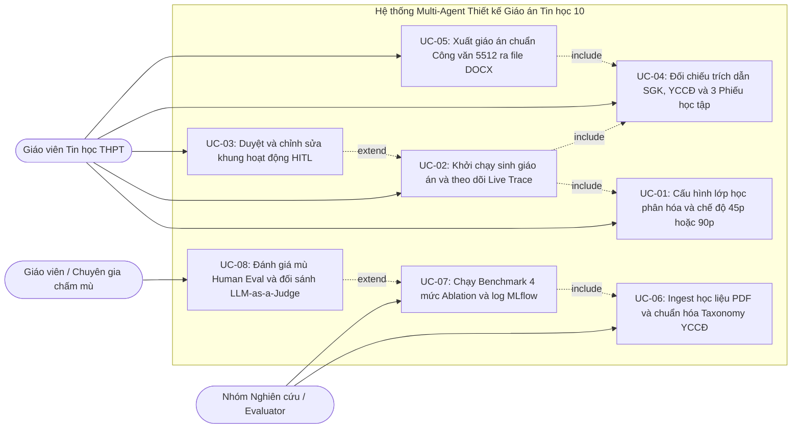
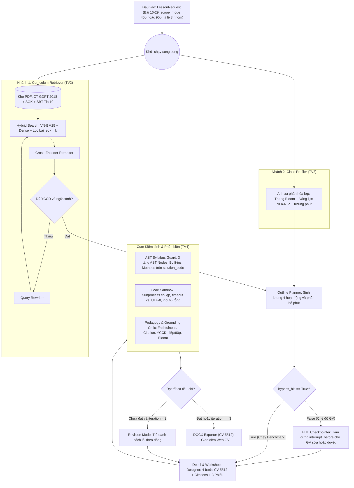
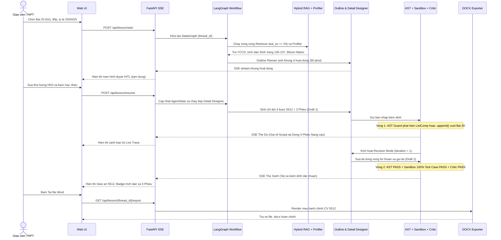
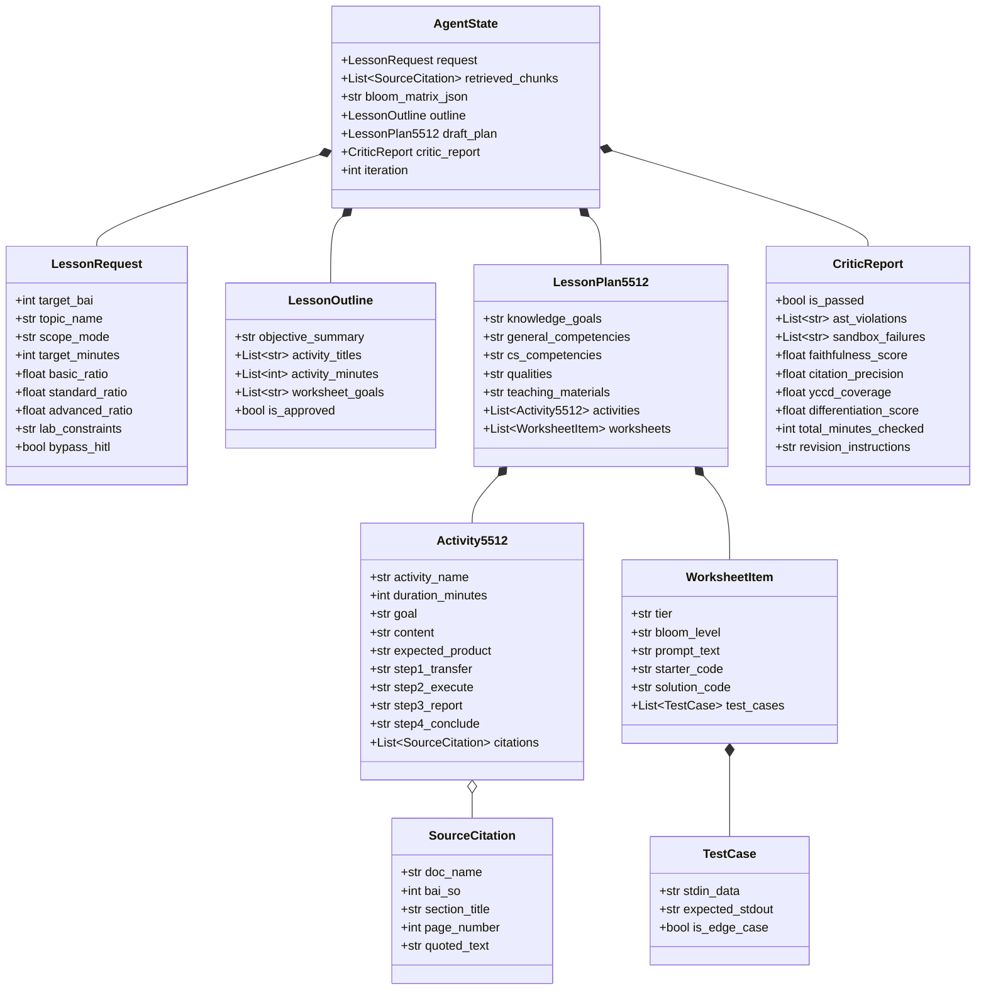

# **TÀI LIỆU THIẾT KẾ HỆ THỐNG & TỔNG HỢP BIỂU ĐỒ (SYSTEM DESIGN SPECIFICATION)**

> **Dự án:** Hệ thống Multi-Agent hỗ trợ giáo viên thiết kế hoạt động giảng dạy bám sát đề cương, giáo trình và tối ưu theo trình độ phân hóa lớp học (Môn Tin học THPT)  
> **Phạm vi MVP:** Chủ đề F – Lập trình Python (Bộ SGK/SBT *Tin học 10 Kết nối tri thức với cuộc sống*, Bài 16 – 29), xuất giáo án chuẩn Phụ lục IV – Công văn 5512/BGDĐT-GDTrH kèm trích dẫn SGK và 3 Phiếu học tập phân hóa theo Bloom.  
> **Tài liệu Kế hoạch triển khai:** [ke_hoach.md](./ke_hoach.md)

---

## **Mục lục**
1. [Thiết kế Use Case & Luồng Nghiệp vụ](#1-thiết-kế-use-case--luồng-nghiệp-vụ)
   - 1.1. [Biểu đồ Use Case Tổng thể](#11-biểu-đồ-use-case-tổng-thể)
   - 1.2. [Bảng Đặc tả Chi tiết 8 Use Case Nghiệp vụ](#12-bảng-đặc-tả-chi-tiết-8-use-case-nghiệp-vụ)
2. [Kiến trúc Hệ thống Multi-Agent](#2-kiến-trúc-hệ-thống-multi-agent)
   - 2.1. [Biểu đồ Kiến trúc LangGraph + Hybrid RAG + HITL + Guardrails](#21-biểu-đồ-kiến-trúc-langgraph--hybrid-rag--hitl--guardrails)
   - 2.2. [Mô tả Luồng Dữ liệu & Các Module Lõi](#22-mô-tả-luồng-dữ-liệu--các-module-lõi)
3. [Luồng Tuần tự Thực thi Kịch bản (Sequence Diagram)](#3-luồng-tuần-tự-thực-thi-kịch-bản-sequence-diagram)
   - 3.1. [Biểu đồ Tuần tự Kịch bản E2E (Ví dụ Bài 20: Câu lệnh lặp for)](#31-biểu-đồ-tuần-tự-kịch-bản-e2e-ví-dụ-bài-20-câu-lệnh-lặp-for)
   - 3.2. [Quy trình Tự sửa lỗi (Self-Correction Reflection Loop)](#32-quy-trình-tự-sửa-lỗi-self-correction-reflection-loop)
4. [Hợp đồng Dữ liệu & Lớp (Class Diagram & Data Contracts)](#4-hợp-đồng-dữ-liệu--lớp-class-diagram--data-contracts)
   - 4.1. [Biểu đồ Hợp đồng Dữ liệu Pydantic (`src/schemas.py`)](#41-biểu-đồ-hợp-đồng-dữ-liệu-pydantic-srcschemaspy)
   - 4.2. [Đặc tả các Thực thể Dữ liệu Trọng yếu](#42-đặc-tả-các-thực-thể-dữ-liệu-trọng-yếu)
5. [Kiến trúc Cấu trúc Thư mục & Phân tầng Module](#5-kiến-trúc-cấu-trúc-thư-mục--phân-tầng-module)

---

## **1. Thiết kế Use Case & Luồng Nghiệp vụ**

### **1.1. Biểu đồ Use Case Tổng thể**

Biểu đồ mô tả tương tác của 3 nhóm tác nhân chính: **Giáo viên Tin học THPT**, **Nhóm Nghiên cứu / Evaluator**, và **Giáo viên / Chuyên gia chấm mù** với 8 Use Case cốt lõi của hệ thống.



---

### **1.2. Bảng Đặc tả Chi tiết 8 Use Case Nghiệp vụ**

| Mã UC | Tên Use Case | Tác nhân | Đầu vào (Input) | Luồng xử lý chính & Xử lý ngoại lệ / Tự sửa lỗi | Đầu ra nghiệm thu (Output) |
| :--- | :--- | :--- | :--- | :--- | :--- |
| **UC-01** | Cấu hình lớp học phân hóa & thời lượng | Giáo viên | Chọn Bài (16–29), `scope_mode` (`45p Lý thuyết` / `45p Thực hành` / `90p Trọn bài`), tỷ lệ 3 nhóm (tổng = 100%), cấu hình phòng máy | UI tự cân bằng 3 thanh trượt về 100%, kiểm tra hợp lệ chỉ số bài và ghi chú ngữ cảnh lớp học trước khi gửi API. Nếu tổng khác 100%, nút khởi chạy bị khóa. | `LessonRequest` JSON hợp lệ |
| **UC-02** | Khởi chạy sinh giáo án & theo dõi Live Trace | Giáo viên | `LessonRequest`, `bypass_hitl = False` | Backend mở luồng SSE, chạy song song `Curriculum Retriever` + `Class Profiler`, hội tụ vào `Outline Planner` rồi tạm dừng trước `Detail Designer`. Sau khi nhận duyệt HITL, vòng lặp `Detail Designer <-> Critic` chạy tối đa 3 vòng; nếu AST/Sandbox/Critic báo lỗi, hiển thị thẻ đỏ kèm dòng lỗi và tự động chuyển sang Revision Mode. | Dòng sự kiện SSE thời gian thực & bản nháp hoàn chỉnh |
| **UC-03** | Duyệt & chỉnh sửa khung hoạt động (HITL) | Giáo viên | Khung 4 hoạt động + phân bổ phút đề xuất từ `Outline Planner` | Đồ thị dừng tại Checkpointer (`interrupt_before`); GV sửa trực tiếp tên hoạt động, phân bổ thời lượng hoặc ghi chú sư phạm rồi bấm *"Xác nhận & Sinh chi tiết"*. Nếu GV chỉnh tổng phút lệch chuẩn 45p/90p, UI cảnh báo cân đối lại. | Payload `POST /resume` cập nhật `AgentState` và tiếp tục luồng |
| **UC-04** | Đối chiếu trích dẫn SGK, YCCĐ & 3 Phiếu học tập | Giáo viên | `LessonPlan5512` đã qua kiểm định | Giao diện hiển thị giáo án chuẩn 5512 kèm **Badge trích dẫn nguồn** (`Tên tài liệu, Bài, Mục, Trang`) trên từng hoạt động và 3 tab Phiếu học tập phân hóa (*Cơ bản – Đạt chuẩn – Nâng cao*) với trạng thái `AST PASS` & `Sandbox PASS`. | Giáo án minh bạch nguồn gốc, 0% vượt chương trình |
| **UC-05** | Xuất giáo án `.docx` chuẩn Công văn 5512 | Giáo viên | `thread_id` đã hoàn tất | Gọi `GET /api/lesson/{thread_id}/export`, `docx_exporter.py` đổ dữ liệu vào template chuẩn hành chính Việt Nam (Phần I Mục tiêu 3 thành phần, Phần II Học liệu, Phần III bảng 2 cột đủ 4 bước CV 5512, Phụ lục 3 Phiếu học tập + code monospace). | File `.docx` tải về không lỗi font tiếng Việt & bảng biểu |
| **UC-06** | Ingest học liệu PDF & chuẩn hóa Taxonomy YCCĐ | Nhóm Nghiên cứu | PDF CT GDPT 2018 (TT 32), SGK + SBT/SGV Tin học 10 KNTT | Docling parse giữ bảng biểu & code Python; tách từ tiếng Việt (`pyvi`/`underthesea`) cho BM25, tạo Vector index kèm metadata `bai_so`, xây dựng `data/yccd_taxonomy.json` và đánh giá `Recall@5`, `MRR` trên 30–50 câu truy vấn chuẩn. | Kho chunk sạch, index Hybrid RAG & báo cáo Retrieval |
| **UC-07** | Chạy Benchmark 4 mức Ablation & log MLflow | Nhóm Nghiên cứu | `eval/test_dataset.json` (10–15 bài × nhiều hồ sơ lớp), `bypass_hitl = True` | Chạy tuần tự 4 cấu hình (`B1` Zero-shot, `B2` Single+RAG, `B3` Multi-Agent+LLM Critic thuần, `B4` Full System) trên cùng 1 base LLM (`temperature=0`), log đầy đủ metric & chi phí lên MLflow, chạy `verify_report_metrics.py` đối soát 100%. | Bảng & biểu đồ Ablation chuẩn trên MLflow |
| **UC-08** | Đánh giá mù Human Eval & đối sánh LLM-as-a-Judge | Chuyên gia / GV | 5–6 bộ giáo án mẫu ẩn danh nguồn sinh (`B2` vs `B4`) | 1–2 giáo viên/sinh viên sư phạm Tin học chấm mù theo rubric 5512 & phân hóa Bloom; hệ thống tính hệ số đồng thuận **Cohen's κ / Spearman ρ** giữa người chấm và LLM-as-a-Judge. | Minh chứng độ tin cậy thang đo & phân tích lỗi (Error Analysis) |

---

## **2. Kiến trúc Hệ thống Multi-Agent**

### **2.1. Biểu đồ Kiến trúc LangGraph + Hybrid RAG + HITL + Guardrails**

Kiến trúc điều phối 6 node bằng **LangGraph**, tích hợp cơ chế rẽ nhánh song song, trạm dừng người thẩm định (Human-In-The-Loop) và cụm kiểm định tất định 3 tầng (AST Syllabus Guard + Code Sandbox + Pedagogy Critic).



---

### **2.2. Mô tả Luồng Dữ liệu & Các Module Lõi**

1. **Khởi chạy Song song (Parallel Branches):**
   - **Nhánh 1 (`Curriculum Retriever`):** Truy hồi tri thức chuẩn từ kho PDF bằng Hybrid Search (**VN-BM25 + Dense Vector**) có lọc metadata `bai_so <= target_bai`. Sau đó qua Cross-Encoder Reranker và Document Grader / Query Rewriter.
   - **Nhánh 2 (`Class Profiler`):** Ánh xạ cấu hình lớp học và thời lượng thành ma trận mục tiêu Bloom, mã năng lực Tin học (`NLa, NLb, NLc`) và phân bổ thời lượng dự kiến.
2. **Hội tụ tại `Outline Planner`:**
   - Tạo khung sườn 4 hoạt động chuẩn 5512 và định hướng 3 phiếu học tập.
3. **Cơ chế HITL (Human-In-The-Loop Checkpointer):**
   - Nếu `bypass_hitl = False`, LangGraph dừng lại tại `interrupt_before`, trả khung hoạt động về UI để giáo viên tùy chỉnh/phê duyệt trước khi bước vào khâu sinh chi tiết (tiết kiệm token).
   - Nếu `bypass_hitl = True`, luồng tự động đi thẳng sang `Detail Designer` để phục vụ chạy benchmark tự động hàng loạt.
4. **Cụm Kiểm định Đa tầng (Critic Hub):**
   - **AST Syllabus Guard (Tất định):** Quét cú pháp `solution_code` trên 3 tầng (AST Node, Built-in, Method) dựa trên `syllabus_rules.json` của Bài 16–29, cấm triệt để cú pháp vượt chương trình.
   - **Code Sandbox (Tất định):** Chạy thực thi `solution_code` với các test cases trong subprocess cô lập (`timeout=2s`, UTF-8, `input()` rỗng).
   - **Pedagogy & Grounding Critic (LLM-based):** Đánh giá độ trung thực (Faithfulness), trích dẫn chính xác, độ phủ YCCĐ, khớp thời lượng 45p/90p và phân hóa Bloom.
5. **Vòng lặp Phản biện & Tự sửa lỗi (Reflection Loop):**
   - Nếu vi phạm bất kỳ tiêu chí nào và số lần lặp `iteration < 3`, hệ thống kích hoạt **Revision Mode** trả lỗi chi tiết theo dòng để `Detail Designer` sửa chữa cục bộ.

---

## **3. Luồng Tuần tự Thực thi Kịch bản (Sequence Diagram)**

### **3.1. Biểu đồ Tuần tự Kịch bản E2E (Ví dụ Bài 20: Câu lệnh lặp `for`)**

Kịch bản thực tế mô phỏng phiên làm việc trọn vẹn: Giáo viên cấu hình Bài 20 (90 phút, tỷ lệ 25/50/25), duyệt khung hoạt động HITL, hệ thống tự phát hiện lỗi vượt chương trình tại Vòng 1 và tự động sửa thành công ở Vòng 2 trước khi xuất bản file `.docx`.



---

### **3.2. Quy trình Tự sửa lỗi (Self-Correction Reflection Loop)**

1. **Giai đoạn phát hiện lỗi (Vòng 1):**
   - `Detail Designer` sinh ra giải thuật có sử dụng cú pháp chưa học ở Bài 20 (ví dụ `[x for x in ...]`, `.append()` hoặc `enumerate()`).
   - `AST Syllabus Guard` phân tích cây cú pháp trừu tượng của `solution_code`, xác định chính xác dòng bị vi phạm và tên cấu trúc vượt chuẩn.
   - Hệ thống phát tín hiệu SSE cảnh báo Thẻ Đỏ lên màn hình Live Trace của người dùng.
2. **Giai đoạn phản hồi sư phạm & sửa đổi (Revision Mode):**
   - `CriticReport` gửi phản hồi dạng cấu trúc chứa: `ast_violations`, `sandbox_failures` và `revision_instructions`.
   - `Detail Designer` nhận chỉ thị, giữ nguyên các phần đã đạt chuẩn và chỉ tạo lại phần mã nguồn thay thế bằng cấu trúc lặp `for` thuần túy hợp lệ.
3. **Giai đoạn nghiệm thu (Vòng 2):**
   - Toàn bộ bài tập vượt qua AST Guard 3 tầng, Sandbox chạy thành công 100% test cases với thời gian thực thi `< 2s`.
   - Hệ thống chuyển sang trạng thái Thẻ Xanh và kích hoạt chức năng xuất file.

---

## **4. Hợp đồng Dữ liệu & Lớp (Class Diagram & Data Contracts)**

### **4.1. Biểu đồ Hợp đồng Dữ liệu Pydantic (`src/schemas.py`)**

Toàn bộ các thực thể trao đổi giữa các Agent và tầng API được chuẩn hóa thành Pydantic Models bất biến (Schema Freeze).



---

### **4.2. Đặc tả các Thực thể Dữ liệu Trọng yếu**

1. **`LessonRequest`:** Đầu vào cấu hình phiên thiết kế, quy định bài học (`target_bai`), chế độ dạy (`scope_mode`: `"45m_theory"`, `"45m_practice"`, `"90m_full"`), tỷ lệ phân hóa 3 tầng (`basic_ratio`, `standard_ratio`, `advanced_ratio` có tổng bằng 1.0) và cờ `bypass_hitl`.
2. **`SourceCitation`:** Định danh trích dẫn học liệu chính xác tới từng trang, mục và đoạn văn trong SGK/SBT (*Tên tài liệu, Bài số, Mục, Trang, Trích đoạn*).
3. **`Activity5512`:** Cấu trúc một hoạt động giảng dạy chuẩn Công văn 5512, bắt buộc phân tách 4 bước tổ chức thực hiện độc lập:
   - `step1_transfer`: Chuyển giao nhiệm vụ
   - `step2_execute`: Thực hiện nhiệm vụ
   - `step3_report`: Báo cáo, thảo luận
   - `step4_conclude`: Kết luận, nhận định
4. **`WorksheetItem`:** Phiếu học tập phân hóa theo Bloom. Tách biệt rõ:
   - `starter_code`: Mã nguồn khung in cho học sinh (có thể có chỗ trống `___`).
   - `solution_code` & `test_cases`: Mã nguồn hoàn chỉnh và bộ dữ liệu kiểm thử dùng riêng cho AST Guard và Code Sandbox.
5. **`CriticReport`:** Kết quả thẩm định đa chiều, bao gồm trạng thái pass/fail, danh sách lỗi vi phạm cú pháp AST, lỗi chạy test case Sandbox, cùng các thang điểm định lượng của LLM Critic.
6. **`AgentState`:** Trạng thái tổng thể được quản lý tập trung và lưu vết qua Checkpointer của LangGraph.

---

## **5. Kiến trúc Cấu trúc Thư mục & Phân tầng Module**

```text
multi-agent-cs-lesson-planner/
├── .github/
│   └── workflows/
│       └── ci.yml                 # (TV1) Auto-run pytest Schema & AST Guard trên mọi PR
├── data/
│   ├── raw_pdfs/                  # (TV2) PDF CT GDPT 2018 (TT 32) & SGK/SBT Tin học 10 KNTT
│   ├── processed/                 # (TV2) Markdown sạch + metadata JSON (có page_number)
│   ├── yccd_taxonomy.json         # (TV2 + TV3) Chuẩn hóa mã YCCĐ & NLa-NLe theo Bài 16-29
│   └── syllabus_rules.json        # (TV4) Quy ước 3 tầng (AST, Built-ins, Methods) Bài 16-29
├── src/
│   ├── schemas.py                 # (TV1) Pydantic models chung (Contract Freeze sau 48h)
│   ├── rag/
│   │   ├── ingest.py              # (TV2) Docling parser, VN segmentation, Vector + BM25 index
│   │   └── hybrid_search.py       # (TV2) Hybrid Search (bai_so <= k) + Cross-Encoder Reranker
│   ├── tools/
│   │   ├── ast_guard.py           # (TV4) Kiểm định cú pháp 3 tầng trên solution_code
│   │   └── code_sandbox.py        # (TV4) Chạy kiểm thử solution_code & test_cases (UTF-8, 2s)
│   ├── prompts/                   # (TV3) System prompts chuẩn CV 5512, Bloom & Revision Mode
│   ├── agents/
│   │   ├── retriever.py           # (TV2) Node truy xuất đề cương + Grader + Query Rewriter
│   │   ├── profiler.py            # (TV3) Node phân tích lớp học (45p/90p) & ma trận Bloom
│   │   ├── outline_planner.py     # (TV3) Node sinh khung 4 hoạt động phục vụ HITL
│   │   ├── detail_designer.py     # (TV3) Node sinh chi tiết 5512 + 3 phiếu + Revision Mode
│   │   └── critic.py              # (TV4) Node kiểm định tổng hợp (AST + Sandbox + LLM Critic)
│   ├── graph/
│   │   └── workflow.py            # (TV1) StateGraph 6 node, HITL Checkpointer, Reflection Loop
│   ├── utils/
│   │   └── docx_exporter.py       # (TV3) Xuất file Word chuẩn Phụ lục IV – CV 5512
│   └── api/
│       └── main.py                # (TV5) FastAPI SSE Streaming, HITL resume & DOCX export
├── frontend/                      # (TV5) Web UI (Slider 100%, Live Trace, Citations, HITL)
├── eval/
│   ├── retrieval_queries.json     # (TV2) 30-50 câu truy vấn chuẩn đánh giá Recall@5 & MRR
│   ├── retrieval_eval.py          # (TV2) Script đo hiệu năng tầng Hybrid RAG
│   ├── test_dataset.json          # (TV4 + TV2) 10-15 bài học x hồ sơ lớp mẫu
│   ├── baselines.py               # (TV4) Code chạy B1 (Zero-shot), B2 (Single+RAG), B3 (No AST/Sandbox)
│   ├── run_benchmark.py           # (TV4) Script chạy Ablation 4 mức & log MLflow
│   └── verify_report_metrics.py   # (TV4) Script kiểm toán số liệu báo cáo khớp 100% MLflow/JSON
├── tests/
│   ├── mocks/                     # (TV1) Mock JSON cho các node & mock SSE stream
│   ├── test_schemas.py            # (TV1) Unit test Pydantic contract
│   ├── test_ast_guard.py          # (TV4) Unit test bắt lỗi 3 tầng vượt chương trình
│   └── test_sandbox.py            # (TV4) Unit test cô lập, timeout & UTF-8 I/O
├── docker-compose.yml             # (TV5)
└── README.md
```
